# VidalStore EP1 y EP2 — Guía Técnica Exhaustiva de Flujos de Punta a Punta y Guion de Defensa

> **Asignatura:** DSY1107 - Desarrollo Cloud Native I (DUOC UC)  
> **Evaluación:** Evaluación Parcial N°1 (EP1) y Evaluación Parcial N°2 (EP2) — Caso VidalStore  
> **Propósito:** Documento de estudio integral, comprensión profunda de la arquitectura distribuida y guion oficial de defensa en vivo (15 minutos cronometrados y demostración de 11 pasos §5.1).  
> **Repositorios involucrados:** `vidalstore-frontend` (Angular), `vidalstore-gateway` (NestJS :8080), `vidalstore-backend` (NestJS :3001), `vidalstore-plataforma` (Docker Compose, Clúster RabbitMQ 4.3 y PostgreSQL 18), `vidalstore-eventos` (Worker NestJS), `vidalstore-admin` (Microservicio Administrador NestJS :3020) y AWS Cognito.

---

## 📑 Índice General de Flujos y Defensa

### Bloque I · Cadena Sincrónica de 4 Capas (EP1)
1. [Topología de la Arquitectura de 4 Capas y Puertos](#1-topología-de-la-arquitectura-de-4-capas-y-puertos)
2. [Flujo 1 · Identidad, Registro y Autenticación (Flujo A Oficial · Hosted UI + PKCE)](#2-flujo-1--identidad-registro-y-autenticación-flujo-a-oficial)
3. [Flujo 2 · Consulta de Catálogo (Lectura Autenticada con Scopes)](#3-flujo-2--consulta-de-catálogo-lectura-autenticada-con-scopes)
4. [Flujo 3 · Lo Propio: Biblioteca Personal (Flujo B Oficial · Agregación Concurrente)](#4-flujo-3--lo-propio-biblioteca-personal-flujo-b-oficial--agregación-concurrente)
5. [Flujo 4 · Compra de Juego (Transacción Distribuida e Idempotencia 409)](#5-flujo-4--compra-de-juego-transacción-distribuida-e-idempotencia-409)
6. [Flujo 5 · Rol Insuficiente y Revocación Administrativa (Flujo C Oficial · 403 Forbidden)](#6-flujo-5--rol-insuficiente-y-revocación-administrativa-flujo-c-oficial--403-forbidden)
7. [Flujo 6 · Defensa en Profundidad y Acceso "Por Detrás" (Flujo D Oficial · 401 Unauthorized)](#7-flujo-6--defensa-en-profundidad-y-acceso-por-detrás-flujo-d-oficial--401-unauthorized)
8. [Flujo 7 · Origen y Trazabilidad de Datos (Flujo E Oficial · Seed y API Externa)](#8-flujo-7--origen-y-trazabilidad-de-datos-flujo-e-oficial--seed-y-api-externa)
9. [Flujo 8 · Auditoría y Registro de Trazabilidad Administrativa](#9-flujo-8--auditoría-y-registro-de-trazabilidad-administrativa)

### Bloque II · Mensajería Asíncrona, Resiliencia y Persistencia (EP2)
10. [Flujo 9 · La Cadena Asincrónica Completa de Punta a Punta (L7 · Postgres y TypeORM)](#10-flujo-9--la-cadena-asincrónica-completa-de-punta-a-punta-l7)
11. [Flujo 10 · El Mensaje Envenenado y la Salida de Emergencia DLQ (L7 · x-death y Cartas Muertas)](#11-flujo-10--el-mensaje-envenenado-y-la-salida-de-emergencia-dlq-l7)
12. [Flujo 11 · Resiliencia ante Caída de Base de Datos y Reintentos (L7 · conReintentos)](#12-flujo-11--resiliencia-ante-caída-de-base-de-datos-y-reintentos-l7)
13. [Flujo 12 · Idempotencia Real y Protección contra Duplicados 23505 (L7 · UNIQUE)](#13-flujo-12--idempotencia-real-y-protección-contra-duplicados-23505-l7)
14. [Flujo 13 · Gestión Administrativa y Observabilidad del Clúster (vidalstore-admin · IE6, IE7, IE8, IE17 e IE18)](#14-flujo-13--gestión-administrativa-y-observabilidad-del-clúster-vidalstore-admin)
15. [Flujo 14 · Reprocesamiento Controlado de Cartas Muertas desde DLQ (Requisito Grupos de 3)](#15-flujo-14--reprocesamiento-controlado-de-cartas-muertas-desde-dlq)
16. [Flujo 15 · Clúster RabbitMQ 2 Nodos, Failover y el Estado Minority (IE9, IE10, IE11)](#16-flujo-15--clúster-rabbitmq-2-nodos-failover-y-el-estado-minority)
17. [Flujo 16 · Políticas de Retención, Limpieza y Desborde (IE19)](#17-flujo-16--políticas-de-retención-limpieza-y-desborde)

### Bloque III · Guiones de Defensa y Marco Metodológico
18. [Protocolo de Defensa en Vivo y Framework Verbal (El Reloj de 15 Minutos de D6)](#18-protocolo-de-defensa-en-vivo-y-framework-verbal-el-reloj-de-15-minutos-de-d6)
19. [Guion Oficial de la Demostración en Vivo de 11 Pasos de la EP2 (§5.1)](#19-guion-oficial-de-la-demostración-en-vivo-de-11-pasos-de-la-ep2-51)
20. [Glosario Técnico y Arquitectónico de VidalStore](#20-glosario-técnico-y-arquitectónico-de-vidalstore)
## 1. Topología de la Arquitectura de 4 Capas y Puertos

```
[ NAVEGADOR WEB (Cliente) ]
       │
       │  http://localhost:4200 (Angular 20 Standalone)
       ▼
┌────────────────────────────────────────────────────────────────────────┐
│ CAPA 1: FRONTEND (vidalstore-frontend)                                 │
│ Puerto: 4200 | Tecnología: Angular 20 Standalone                       │
│ Responsabilidad: Renderizado SPA, guards de ruta, UI reactiva (signals)│
│ Restricción: Habla con UNA SOLA DIRECCIÓN (http://localhost:8080)      │
└──────────────────────────────────┬─────────────────────────────────────┘
                                   │ HTTP con Authorization: Bearer <JWT>
                                   ▼
┌────────────────────────────────────────────────────────────────────────┐
│ CAPA 2: API GATEWAY (vidalstore-gateway)                               │
│ Puerto: 8080 | Tecnología: NestJS                                      │
│ Responsabilidad: Perímetro de seguridad, CORS estricto (4200),         │
│ validación criptográfica JWKS de Cognito, filtrado por Scopes OAuth2   │
└──────────────────────────────────┬─────────────────────────────────────┘
                                   │ HTTP Forward con Authorization: Bearer <JWT>
                                   ▼
┌────────────────────────────────────────────────────────────────────────┐
│ CAPA 3: BACKEND FOR FRONTEND / BFF (vidalstore-backend)                │
│ Puerto: 3001 | Tecnología: NestJS (src/main.ts)                        │
│ Responsabilidad: Orquestación, agregación concurrente (Promise.all),   │
│ resolución de identidad por 'sub', autorización RBAC por grupos        │
└───────┬──────────────────┬──────────────────┬──────────────────┬───────┘
        │                  │                  │                  │
        │ HTTP (Bearer)    │ HTTP (Bearer)    │ HTTP (Bearer)    │ HTTP (Bearer)
        ▼                  ▼                  ▼                  ▼
┌──────────────┐   ┌──────────────┐   ┌──────────────┐   ┌──────────────┐
│  MS CATÁLOGO │   │  MS COMPRAS  │   │MS BIBLIOTECA │   │ MS AUDITORÍA │
│ Puerto: 3002 │   │ Puerto: 3003 │   │ Puerto: 3004 │   │ Puerto: 3005 │
│ Proceso HTTP │   │ Proceso HTTP │   │ Proceso HTTP │   │ Proceso HTTP │
│ Independiente│   │ Independiente│   │ Independiente│   │ Independiente│
└──────────────┘   └──────────────┘   └──────────────┘   └──────────────┘
        ▲                                                        ▲
        └────────────────────── NUBE AWS ────────────────────────┘
                       AWS Cognito User Pool: us-east-1_psIVfR8PP
                       App Client: 12v3u871cpt4r6tqkm3j66en8i
```

---

## 2. Flujo 1 · Identidad, Registro y Autenticación (Flujo A Oficial)

> **Pregunta de Defensa:** _"¿Cómo pasa un usuario anónimo a ser un sujeto identificado en VidalStore?"_

> ⚡ **Resumen Técnico:** Angular intercepta la navegación con `sesionGuard` (`session.guard.ts`). Al no haber sesión, redirige al Hosted UI de Cognito vía Amplify con flujo Authorization Code + PKCE (`responseType: "code"`). Cognito autentica al usuario y redirige a `http://localhost:4200/callback` con un `code`. El componente `Callback` intercambia el código por tokens contra `/oauth2/token` y los almacena en `sessionStorage` (`cognitoUserPoolsTokenProvider.setKeyValueStorage(sessionStorage)` en `main.ts`). Para resolver la "Trampa de Cognito" (auto-registro sin grupos), el `groups.guard.ts` del backend asigna por omisión en memoria el rol de menor privilegio `["jugadores"]`.
>
> 💡 **En Palabras Simples:** Al intentar entrar a los juegos, el guardia de la puerta (`sesionGuard`) ve que no tienes pulsera y te manda a la boletería oficial de AWS (Cognito Hosted UI). Allí pones tu clave, te dan un vale temporal (`code`) y te mandan a recepción (`/callback`). Recepción cambia el vale por tu pulsera oficial con chip (`JWT`), te la guarda en el bolsillo temporal (`sessionStorage`, para que si cierras la pestaña se destruya) y, como eres nuevo, te asigna la categoría estándar de "jugador común".


### 2.1 Diagrama de Secuencia

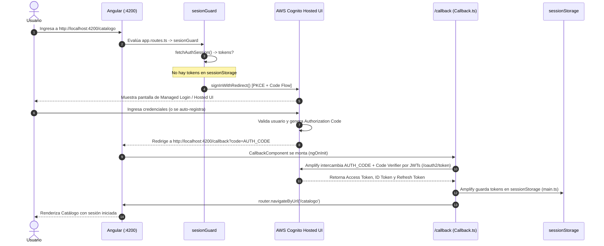

### 2.2 Recorrido Paso a Paso en el Código Real

#### Paso 1: Protección de Rutas en Angular

- **Archivo:** [`vidalstore-frontend/src/app/app.routes.ts`](file:///Users/oscar/Downloads/DUOC/CloudNative/Evaluacion%202/vidalstore-frontend/src/app/app.routes.ts#L11-L15)
- **Código:**
  ```typescript
  export const routes: Routes = [
    { path: '', redirectTo: 'catalogo', pathMatch: 'full' },
    { path: 'catalogo', component: Catalogo , canActivate: [sesionGuard] },
    { path: 'biblioteca', component: Biblioteca, canActivate: [sesionGuard] },
    { path: 'callback', component: Callback },
  ```
- **Explicación:** Las rutas `/catalogo` y `/biblioteca` exigen sesión activa. No hay vistas públicas salvo login/callback.

#### Paso 2: El Guard de Sesión y Redirección a Cognito

- **Archivo:** [`vidalstore-frontend/src/app/auth/session.guard.ts`](file:///Users/oscar/Downloads/DUOC/CloudNative/Evaluacion%202/vidalstore-frontend/src/app/auth/session.guard.ts#L4-L15)
- **Código:**
  ```typescript
  export const sesionGuard: CanActivateFn = async () => {
    const { tokens } = await fetchAuthSession();

    // Si existe un access token válido, permite el acceso a la ruta
    if (tokens?.accessToken) {
      return true;
    }

    // Si no hay sesión, redirige automáticamente al Managed Login de Cognito
    await signInWithRedirect();
    return false;
  };
  ```
- **Explicación:** Si no hay token en `sessionStorage`, ejecuta `signInWithRedirect()`, que genera el desafío criptográfico PKCE (`code_challenge`) y redirige al dominio OAuth2 de Cognito.

#### Paso 3: Configuración de Amplify y `sessionStorage` (Obligatorio por Rúbrica)

- **Archivo:** [`vidalstore-frontend/src/main.ts`](file:///Users/oscar/Downloads/DUOC/CloudNative/Evaluacion%202/vidalstore-frontend/src/main.ts#L13-L31)
- **Código:**

  ```typescript
  Amplify.configure({
    Auth: {
      Cognito: {
        userPoolId: "us-east-1_psIVfR8PP",
        userPoolClientId: "12v3u871cpt4r6tqkm3j66en8i",
        loginWith: {
          oauth: {
            domain: "us-east-1psivfr8pp.auth.us-east-1.amazoncognito.com",
            scopes: [
              "openid",
              "profile",
              "vidalstore/catalogo.leer",
              "vidalstore/catalogo.escribir",
              "vidalstore/biblioteca.leer",
            ],
            redirectSignIn: [`${redirectUri}/callback`],
            redirectSignOut: [redirectUri],
            responseType: "code", // PKCE Authorization Code Grant
          },
        },
      },
    },
  });

  cognitoUserPoolsTokenProvider.setKeyValueStorage(sessionStorage);
  ```

- **Punto Clave de Defensa:** Se usa `cognitoUserPoolsTokenProvider.setKeyValueStorage(sessionStorage)` para corregir la vulnerabilidad forense de almacenar credenciales en `localStorage`. Al cerrar la pestaña, la sesión se destruye automáticamente.

#### Paso 4: Captura del Callback y Redirección al Catálogo

- **Archivo:** [`vidalstore-frontend/src/app/callback/callback.ts`](file:///Users/oscar/Downloads/DUOC/CloudNative/Evaluacion%202/vidalstore-frontend/src/app/callback/callback.ts#L16-L27)
- **Código:**
  ```typescript
  async ngOnInit(): Promise<void> {
    try {
      const { tokens } = await fetchAuthSession();
      if (tokens?.accessToken) {
        await this.router.navigateByUrl('/catalogo');
      } else {
        this.estado.set('No se encontró una sesión activa.');
      }
    } catch {
      this.estado.set('No se pudo validar la sesión. Intenta iniciar sesión nuevamente.');
    }
  }
  ```

#### Paso 5: Resolución de la "Trampa de Cognito" en el Backend

- **Problema:** Al auto-registrarse un usuario mediante Hosted UI, AWS Cognito crea el usuario sin asignarlo a ningún grupo (`cognito:groups` viene vacío o ausente en el payload del JWT).
- **Archivo:** [`vidalstore-backend/src/auth/guards/groups.guard.ts`](file:///Users/oscar/Downloads/DUOC/CloudNative/Evaluacion%202/vidalstore-backend/src/auth/guards/groups.guard.ts#L41-L51)
- **Código Real (Salida A Defensiva):**
  ```typescript
  // Salida A defensiva: Si el token no tiene grupos asignados (ej. auto-registro),
  // se asume en memoria el rol de menor privilegio ('jugadores').
  const rawGroups: string[] =
    Array.isArray(user.grupos) && user.grupos.length > 0
      ? user.grupos
      : Array.isArray(user["cognito:groups"])
        ? user["cognito:groups"]
        : [];
  const userGroups: string[] = rawGroups.length > 0 ? rawGroups : ["jugadores"];
  ```
- **Resultado:** Cualquier usuario recién registrado asume el rol de menor privilegio (`jugadores`), pudiendo comprar y ver su biblioteca, pero quedando bloqueado de las rutas administrativas.

---

## 3. Flujo 2 · Consulta de Catálogo (Lectura Autenticada con Scopes)

> **Pregunta de Defensa:** _"¿Por qué el Gateway permite ver el catálogo y cómo se valida que el token sea auténtico?"_

> ⚡ **Resumen Técnico:** Angular invoca `VidalStoreService.getCatalogo()` hacia `http://localhost:8080/v1/catalogo`. El `tokenInterceptor` inyecta la cabecera `Authorization: Bearer <JWT>`. El API Gateway (`:8080`) ejecuta `AuthGuard` (valida criptográficamente el JWT contra el JWKS de Cognito con RS256, vigencia, emisor y `client_id`) y `ScopesGuard` (valida el claim `scope` con `vidalstore/catalogo.leer`). El Gateway reenvía la petición al BFF (`:3001`), que revalida y reenvía vía HTTP al Microservicio de Catálogo (`:3002`), el cual retorna `catalogo.json` con código `200 OK`.
>
> 💡 **En Palabras Simples:** Quieres ver los juegos disponibles. Tu navegador le pega tu sello digital (`Bearer Token`) a la carta. La caseta de guardia perimetral (Gateway en puerto 8080) revisa que el sello sea auténtico de AWS y que tengas permiso de "mirar vitrina" (`scope`). Si todo está en orden, se la pasa al recepcionista (BFF), quien le pide la lista a la bodega de catálogo (puerto 3002) y te la devuelve lista en pantalla.


### 3.1 Diagrama de Secuencia

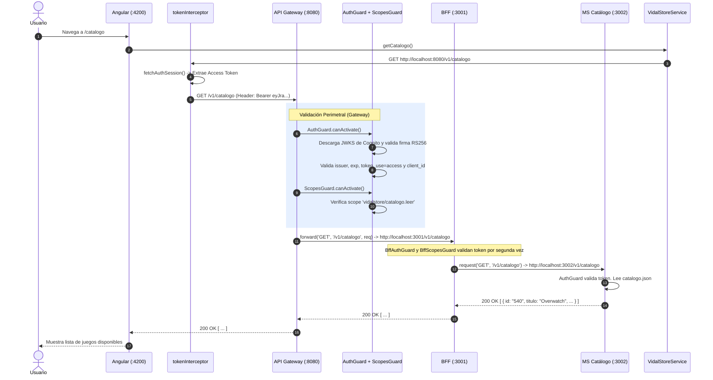

### 3.2 Recorrido Paso a Paso en el Código Real

#### Paso 1: Llamada en el Servicio Angular

- **Archivo:** [`vidalstore-frontend/src/app/services/vidalstore.ts`](file:///Users/oscar/Downloads/DUOC/CloudNative/Evaluacion%202/vidalstore-frontend/src/app/services/vidalstore.ts#L61-L64)
- **Código:**
  ```typescript
  getCatalogo(): Observable<Juego[]> {
    return this.http.get<Juego[]>(`${this.gatewayUrl}/v1/catalogo`);
  }
  ```
- **Regla Estricta:** La URL apunta **exclusivamente** a `http://localhost:8080` (Gateway).

#### Paso 2: Interceptor Inyecta el JWT en la Cabecera

- **Archivo:** [`vidalstore-frontend/src/app/auth/token.interceptor.ts`](file:///Users/oscar/Downloads/DUOC/CloudNative/Evaluacion%202/vidalstore-frontend/src/app/auth/token.interceptor.ts#L5-L24)
- **Código:**

  ```typescript
  const PERMITIDOS = ["http://localhost:8080"];

  export const tokenInterceptor: HttpInterceptorFn = (req, next) => {
    const esPermitido =
      PERMITIDOS.some((base) => req.url.startsWith(base)) ||
      req.url.startsWith("/v1");
    if (!esPermitido) {
      return next(req);
    }

    return from(fetchAuthSession()).pipe(
      switchMap(({ tokens }) => {
        const jwt = tokens?.accessToken?.toString();
        const setHeaders: Record<string, string> = {
          "ngrok-skip-browser-warning": "true",
        };
        if (jwt) {
          setHeaders["Authorization"] = `Bearer ${jwt}`;
        }
        return next(req.clone({ setHeaders }));
      }),
    );
  };
  ```

#### Paso 3: Validación Criptográfica en el Gateway (`AuthGuard` + `AuthService`)

- **Archivo:** [`vidalstore-gateway/src/gateway.controller.ts`](file:///Users/oscar/Downloads/DUOC/CloudNative/Evaluacion%202/vidalstore-gateway/src/gateway.controller.ts#L24-L30)
- **Código:**
  ```typescript
  @Get('catalogo')
  @UseGuards(AuthGuard, ScopesGuard)
  @RequireScopes('vidalstore/catalogo.leer')
  async getCatalogo(@Request() req: ExpressRequest) {
    return this.gatewayService.forward('GET', '/v1/catalogo', req);
  }
  ```
- **Archivo:** [`vidalstore-gateway/src/auth/auth.service.ts`](file:///Users/oscar/Downloads/DUOC/CloudNative/Evaluacion%202/vidalstore-gateway/src/auth/auth.service.ts#L20-L66)
  1. Extrae el `kid` del header del token.
  2. Obtiene la clave pública desde el JWKS de AWS Cognito (`jwks-rsa`).
  3. Ejecuta `jwt.verify(token, publicKey, { algorithms: ['RS256'], issuer })`.
  4. Valida que `payload.token_use === 'access'`.
  5. Valida que `payload.client_id === process.env.COGNITO_CLIENT_ID`.
  6. Si alguna falla, lanza `UnauthorizedException` (`401`).

#### Paso 4: Validación de Scopes en el Gateway (`ScopesGuard`)

- **Archivo:** [`vidalstore-gateway/src/auth/scopes.guard.ts`](file:///Users/oscar/Downloads/DUOC/CloudNative/Evaluacion%202/vidalstore-gateway/src/auth/scopes.guard.ts#L33-L47)
- **Código:**

  ```typescript
  const tokenScopeString: string = user.scope || "";
  const userScopes = tokenScopeString
    .split(" ")
    .map((s) => s.trim())
    .filter(Boolean);

  const hasAllScopes = requiredScopes.every((scope) =>
    userScopes.includes(scope),
  );
  if (!hasAllScopes) {
    throw new ForbiddenException(
      `Acceso denegado: falta el scope requerido...`,
    );
  }
  ```

#### Paso 5: Forward y Despacho del Microservicio Catálogo

- **Archivo:** [`vidalstore-gateway/src/gateway.service.ts`](file:///Users/oscar/Downloads/DUOC/CloudNative/Evaluacion%202/vidalstore-gateway/src/gateway.service.ts#L14-L37)
  - Hace fetch a `http://localhost:3001/v1/catalogo` reenviando el `Authorization: Bearer <token>`.
- **Archivo:** [`vidalstore-backend/src/bff/catalogo/bff-catalogo.controller.ts`](file:///Users/oscar/Downloads/DUOC/CloudNative/Evaluacion%202/vidalstore-backend/src/bff/catalogo/bff-catalogo.controller.ts#L29-L39)
  - Reenvía la petición al microservicio de Catálogo en `http://localhost:3002/v1/catalogo`.
- **Archivo:** [`vidalstore-backend/src/microservicios/catalogo/catalogo.controller.ts`](file:///Users/oscar/Downloads/DUOC/CloudNative/Evaluacion%202/vidalstore-backend/src/microservicios/catalogo/catalogo.controller.ts#L26-L29)
  - Retorna el catálogo cargado en memoria desde `catalogo.json` con código HTTP `200 OK`.

---

## 4. Flujo 3 · Lo Propio: Biblioteca Personal (Flujo B Oficial · Agregación Concurrente)

> **Pregunta de Defensa:** _"¿Cómo garantiza VidalStore que un jugador solo vea sus propios juegos y cómo se optimiza la consulta?"_

> ⚡ **Resumen Técnico:** El frontend realiza **una sola llamada de red** a `GET http://localhost:8080/v1/biblioteca`. El Gateway valida token y scope `vidalstore/biblioteca.leer`. En el BFF (`:3001`), `bff-biblioteca.controller.ts` extrae la identidad **únicamente del claim `sub` del token** (`@CurrentUser("sub")`), previniendo vulnerabilidades BOLA/IDOR al no aceptar `userId` por parámetro. El BFF lanza concurrentemente con `Promise.all` dos peticiones: a MS Biblioteca (`:3004/v1/biblioteca`, que filtra por `sub`) y a MS Catálogo (`:3002/v1/catalogo`). Luego cruza en memoria en $O(N)$ usando `new Map()` para enriquecer cada licencia con los datos de su juego y retorna `200 OK` (o `[]` si está vacía).
>
> 💡 **En Palabras Simples:** Quieres ver tus juegos comprados. Haces una sola pregunta a la entrada. La regla de oro es que **tú nunca dices tu ID**: tu identidad la dice el chip inalterable de tu pulsera (`sub`). El recepcionista interno (BFF), para no hacerte esperar el doble, manda dos mensajeros al mismo tiempo (`Promise.all`): uno a la bodega de licencias (puerto 3004) a buscar tus contratos y otro a la de catálogo (puerto 3002) a traer títulos y carátulas. En su escritorio junta cada juego con su código usando un casillero rápido (`Map`) y te entrega tu colección completa en un solo paquete. Si no tienes juegos, responde amablemente "tienes 0 juegos" (`200 OK []`), jamás un error.


### 4.1 Diagrama de Secuencia

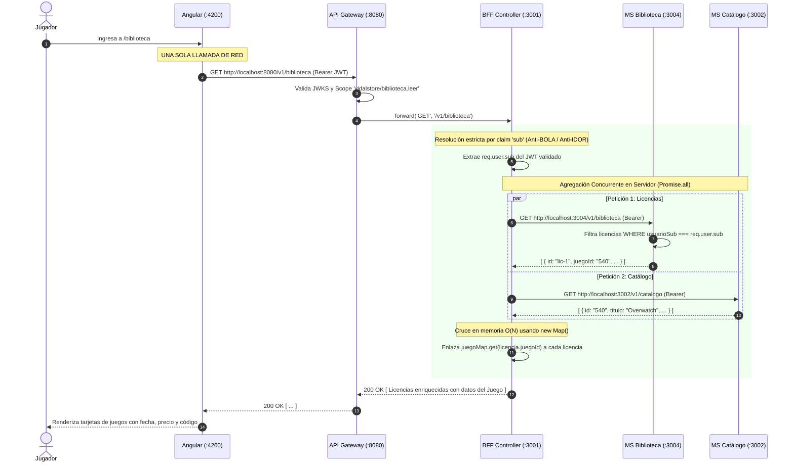

### 4.2 Recorrido Paso a Paso en el Código Real

#### Paso 1: Prohibición de Parámetro `userId` (Prevención de Vulnerabilidad BOLA/IDOR)

- En VidalStore está **estrictamente prohibido** enviar `GET /v1/biblioteca?userId=123` o `GET /v1/biblioteca/usuario/123`.
- Si se aceptara el ID por URL o body, cualquier usuario podría cambiar el número e inspeccionar la biblioteca de otra persona.
- La identidad se extrae **exclusivamente del claim criptográfico `sub`** inalterable del JWT.

#### Paso 2: El Controlador del BFF y la Agregación con `Promise.all`

- **Archivo:** [`vidalstore-backend/src/bff/biblioteca/bff-biblioteca.controller.ts`](file:///Users/oscar/Downloads/DUOC/CloudNative/Evaluacion%202/vidalstore-backend/src/bff/biblioteca/bff-biblioteca.controller.ts#L20-L58)
- **Código:**

  ```typescript
  @Get()
  @UseGuards(BffAuthGuard)
  async obtenerBiblioteca(
    @CurrentUser('sub') usuarioSub: string,
    @Req() req?: any,
  ) {
    if (!usuarioSub) {
      throw new UnauthorizedException(
        'No se pudo resolver la identidad del usuario a partir del claim sub del token.',
      );
    }

    const authHeader = req?.headers?.['authorization'];

    // Agregación concurrente en servidor con Promise.all (latencia max(T1, T2))
    const [licencias, catalogo] = await Promise.all([
      this.bffHttpService.request<Licencia[]>(
        this.bffHttpService.bibliotecaUrl,
        'GET',
        '/v1/biblioteca',
        authHeader,
      ),
      this.bffHttpService
        .request<Juego[]>(
          this.bffHttpService.catalogoUrl,
          'GET',
          '/v1/catalogo',
          authHeader,
        )
        .catch(() => [] as Juego[]),
    ]);

    // Cruce de datos O(N) con Map
    const juegoMap = new Map<string, Juego>(catalogo.map((j) => [j.id, j]));

    return licencias.map((licencia) => ({
      ...licencia,
      juego: juegoMap.get(licencia.juegoId) ?? null,
    }));
  }
  ```

#### Paso 3: Filtrado en el Microservicio de Biblioteca

- **Archivo:** [`vidalstore-backend/src/microservicios/biblioteca/biblioteca.controller.ts`](file:///Users/oscar/Downloads/DUOC/CloudNative/Evaluacion%202/vidalstore-backend/src/microservicios/biblioteca/biblioteca.controller.ts#L23-L27)
- **Código:**
  ```typescript
  @Get()
  obtenerBiblioteca(@Req() req: any) {
    const usuarioSub = req.user?.sub;
    return this.bibliotecaService.buscarLicenciasPorUsuario(usuarioSub);
  }
  ```
- **Regla Semántica HTTP:** Si el usuario no tiene ninguna licencia, retorna **`200 OK` con un arreglo vacío `[]`**. Jamás 404 ni 403 (evita vulnerabilidad de enumeración de recursos).

---

## 5. Flujo 4 · Compra de Juego (Transacción Distribuida e Idempotencia 409)

> **Pregunta de Defensa:** _"¿Qué pasa si un usuario presiona dos veces el botón de comprar o compra un juego que ya tiene?"_

> ⚡ **Resumen Técnico:** Angular envía `POST http://localhost:8080/v1/compras` con `{ juegoId, metodoPago, pagoConfirmado }`. El Gateway reenvía al BFF (`:3001`) y este al MS Compras (`:3003`). `ComprasService` extrae `sub` del JWT y llama vía HTTP a MS Catálogo (`:3002`) para verificar existencia y precio real. Luego solicita a MS Biblioteca (`:3004`) crear la licencia. `BibliotecaService` valida idempotencia: si ya existe una licencia para ese `usuarioSub` y `juegoId`, retorna **`409 Conflict`**. Si es nueva, genera un `codigoCanje` único (`VS-XXXX...`), almacena la licencia con `estadoPago: "aprobado"` y retorna `201 Created`.
>
> 💡 **En Palabras Simples:** Haces clic en "Comprar". Tu pedido pasa al encargado de ventas (MS Compras). Primero llama por teléfono interno a bodega (Catálogo) para comprobar que el juego exista y cuál es su precio real (evitando que el usuario manipule el precio desde el navegador). Si existe, llama a la notaría de licencias (Biblioteca). La notaría revisa su libro: si ve que ya tienes ese juego, te frena en seco con un `409 Conflict` ("¡Ya tienes este juego, no te lo puedo duplicar!"). Si es nuevo, genera un código de canje oficial (`VS-...`), lo registra a tu nombre y te confirma la adquisición (`201 Created`).


### 5.1 Diagrama de Secuencia

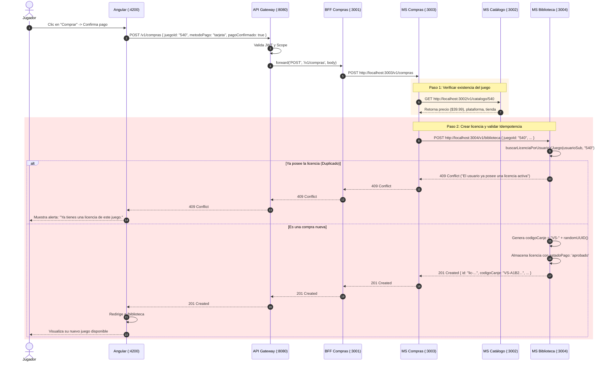

### 5.2 Recorrido Paso a Paso en el Código Real

#### Paso 1: Orquestación en el Microservicio de Compras

- **Archivo:** [`vidalstore-backend/src/microservicios/compras/compras.service.ts`](file:///Users/oscar/Downloads/DUOC/CloudNative/Evaluacion%202/vidalstore-backend/src/microservicios/compras/compras.service.ts#L41-L82)
- **Código:**

  ```typescript
  // 1. Verificar que el juego exista preguntándole al microservicio de Catálogo
  const juego = await this.comprasHttpService.request<{
    precio?: number;
    plataforma?: Licencia["plataforma"];
    tienda?: Licencia["tienda"];
    region?: Licencia["region"];
  }>(
    this.comprasHttpService.catalogoUrl,
    "GET",
    `/v1/catalogo/${juegoId}`,
    token,
  );

  // 2. Crear la licencia en el microservicio de Biblioteca
  const datosLicencia = {
    juegoId,
    plataforma: juego.plataforma,
    tienda: juego.tienda,
    region: juego.region,
    metodoPago,
    referenciaPago: `SIM-${Date.now()}`,
    precioPagado: juego.precio,
    estadoPago: "aprobado" as const,
  };

  return this.comprasHttpService.request<Licencia>(
    this.comprasHttpService.bibliotecaUrl,
    "POST",
    "/v1/biblioteca",
    token,
    datosLicencia,
  );
  ```

#### Paso 2: Validación de Idempotencia y Generación en Biblioteca

- **Archivo:** [`vidalstore-backend/src/microservicios/biblioteca/biblioteca.service.ts`](file:///Users/oscar/Downloads/DUOC/CloudNative/Evaluacion%202/vidalstore-backend/src/microservicios/biblioteca/biblioteca.service.ts#L49-L62)
- **Código:**

  ```typescript
  const licenciaExistente = this.buscarLicenciaPorUsuarioYJuego(
    usuarioSub,
    licenciaDatos.juegoId,
  );
  if (licenciaExistente) {
    throw new ConflictException(
      `El usuario ya posee una licencia activa para el juego con ID '${licenciaDatos.juegoId}'.`,
    );
  }

  return this.storageService.agregarLicencia({
    ...licenciaDatos,
    usuarioSub,
    codigoCanje: `VS-${randomUUID().replaceAll("-", "").slice(0, 16).toUpperCase()}`,
    estadoPago: "aprobado",
  });
  ```

- **Por qué 409 Conflict:** Cumple el estándar REST de idempotencia. Evita cobros dobles y duplicación de licencias para un mismo usuario.

---

## 6. Flujo 5 · Rol Insuficiente y Revocación Administrativa (Flujo C Oficial · 403 Forbidden)

> **Pregunta de Defensa:** _"¿Qué pasa si un atacante envía una petición con un token válido de jugador para revocar una licencia o ver datos de otros?"_

> ⚡ **Resumen Técnico:** Demostración de RBAC y seguridad en el servidor. Si un usuario con rol `jugadores` intenta ejecutar `DELETE /v1/licencias/:id`, el Gateway valida la firma del token y reenvía al BFF (`:3001`). `BffLicenciasController` cuenta con el decorador `@RequireGroups("administradores")`. `BffGroupsGuard` inspecciona `cognito:groups` en el JWT; al no encontrar `administradores`, corta inmediatamente con **`403 Forbidden`**, comprobando que la seguridad reside en el servidor y no en la UI. Cuando lo invoca un administrador legítimo, el BFF ejecuta borrado lógico en MS Biblioteca (`:3004`) y registra en MS Auditoría (`:3005`) el evento con `adminSub`, `usuarioSub`, `juegoId` y motivo, respondiendo `200 OK`.
>
> 💡 **En Palabras Simples:** Un cliente común intenta meterse a la oficina de administración para revocarle un juego a otra persona. Aunque su pulsera sea original, el guardia del pasillo (`BffGroupsGuard`) mira su rango y le dice: "Tu pulsera es válida, pero eres cliente y esto es exclusivo para administradores", cerrándole la puerta con un `403 Prohibido`. Esto demuestra que aunque alguien hackee la pantalla o muestre botones ocultos, el servidor nunca lo deja pasar. Si entra el administrador real, anula la licencia marcándola como devuelta (borrado lógico para no borrar el historial) y anota en el libro de seguridad (Auditoría) quién fue, a quién se la quitó y el motivo.


### 6.1 Diagrama de Secuencia

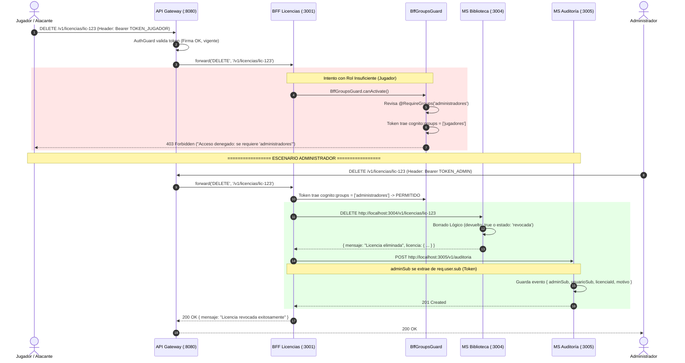

### 6.2 Recorrido Paso a Paso en el Código Real

#### Paso 1: El Guard de Grupos del BFF (`BffGroupsGuard`)

- **Archivo:** [`vidalstore-backend/src/auth/guards/groups.guard.ts`](file:///Users/oscar/Downloads/DUOC/CloudNative/Evaluacion%202/vidalstore-backend/src/auth/guards/groups.guard.ts#L52-L60)
- **Código:**

  ```typescript
  const hasAnyGroup = requiredGroups.some((group) =>
    userGroups.includes(group),
  );

  if (!hasAnyGroup) {
    throw new ForbiddenException(
      `Acceso denegado: se requiere pertenecer a uno de los grupos [${requiredGroups.join(", ")}]. Grupos actuales del usuario: [${userGroups.join(", ")}]`,
    );
  }
  ```

- **Principio de Seguridad:** Demuestra que **la seguridad reside en el servidor**, no en si el botón de revocar está visible o no en Angular.

#### Paso 2: Revocación y Trazabilidad en Auditoría

- **Archivo:** [`vidalstore-backend/src/bff/biblioteca/bff-licencias.controller.ts`](file:///Users/oscar/Downloads/DUOC/CloudNative/Evaluacion%202/vidalstore-backend/src/bff/biblioteca/bff-licencias.controller.ts#L56-L108)
- **Código:**

  ```typescript
  @Delete(':licenciaId')
  @UseGuards(BffAuthGuard, BffGroupsGuard)
  @RequireGroups('administradores')
  async revocarLicencia(
    @Param('licenciaId') licenciaId: string,
    @CurrentUser('sub') adminSub: string,
    @Req() req?: any,
  ) {
    // 1. Eliminar licencia en microservicio de biblioteca
    const deleteResult = await this.bffHttpService.request<{
      mensaje: string;
      licencia: Licencia;
    }>(
      this.bffHttpService.bibliotecaUrl,
      'DELETE',
      `/v1/licencias/${licenciaId}`,
      authHeader,
    );

    // 2. Registrar evento en microservicio de auditoría
    await this.bffHttpService.request(
      this.bffHttpService.auditoriaUrl,
      'POST',
      '/v1/auditoria',
      authHeader,
      {
        adminSub: adminSub || 'admin',
        usuarioSub: licencia?.usuarioSub || 'desconocido',
        juegoId: licencia?.juegoId || 'desconocido',
        licenciaId,
        motivo: 'Revocación administrativa',
      },
    );
  ```

---

## 7. Flujo 6 · Defensa en Profundidad y Acceso "Por Detrás" (Flujo D Oficial · 401 Unauthorized)

> **Pregunta de Defensa:** _"Si un atacante descubre la IP y el puerto del BFF (3001) o de un microservicio (3004) y se salta el Gateway, ¿puede acceder a los datos?"_

> ⚡ **Resumen Técnico:** Arquitectura de defensa en profundidad en dos saltos y cero confianza. Si una petición llega al Gateway sin cabecera `Authorization`, `AuthGuard` responde `401 Unauthorized`. Si un atacante descubre la IP/puerto del BFF (`:3001`) o de un microservicio (`:3004`) e intenta saltarse el Gateway llamando directo sin token, cada servicio posee su propio `AuthGuard` y corta con **`401 Unauthorized`** (no hay confianza ciega downstream). Si el token tiene firma alterada o un `client_id` ajeno a la aplicación, `AuthService` lo rechaza con `401`. Además, CORS está habilitado **exclusivamente en el Gateway** (`http://localhost:4200`); BFF y microservicios bloquean peticiones cross-origin directas del navegador.
>
> 💡 **En Palabras Simples:** Es como un castillo con doble muralla. La primera muralla es el Gateway: si llegas sin invitación, no pasas (`401`). Si un intruso descubre la puerta trasera de la cocina (BFF) o del depósito (microservicios), cada cuarto tiene su propio guardia con lector de pulseras que exige credencial válida firmada por AWS. Ningún cuarto interno asume que "si estás aquí es porque ya te revisaron afuera". Y si la pulsera está raspada o falsificada, salta la alarma. Además, las puertas traseras no atienden a nadie que venga desde navegadores externos (CORS bloqueado).


### 7.1 Matriz de Comportamiento Defensivo

| Intento de Ataque             | Destino                 | Cabecera / Condición       |  Código de Respuesta   | Componente que corta       |
| ----------------------------- | ----------------------- | -------------------------- | :--------------------: | -------------------------- |
| Petición sin token            | Gateway (`:8080`)       | Sin `Authorization`        | **`401 Unauthorized`** | `Gateway AuthGuard`        |
| Petición sin token directa    | BFF (`:3001`)           | Sin `Authorization`        | **`401 Unauthorized`** | `BFF BffAuthGuard`         |
| Petición sin token directa    | MS Biblioteca (`:3004`) | Sin `Authorization`        | **`401 Unauthorized`** | `Microservicio AuthGuard`  |
| Token con firma alterada      | Gateway o BFF           | Firma adulterada           | **`401 Unauthorized`** | `AuthService.validarToken` |
| Token de otra App (Client 2)  | Gateway o BFF           | `client_id` diferente      | **`401 Unauthorized`** | `AuthService.validarToken` |
| Petición cross-origin directa | BFF o Microservicio     | Desde navegador (`Origin`) |    **Bloqueo CORS**    | No tienen CORS habilitado  |

### 7.2 Recorrido en el Código Real

#### 1. Validación en el Salto del Perímetro (Gateway)

- **Archivo:** [`vidalstore-gateway/src/auth/auth.guard.ts`](file:///Users/oscar/Downloads/DUOC/CloudNative/Evaluacion%202/vidalstore-gateway/src/auth/auth.guard.ts#L18-L24)
- **Código:**
  ```typescript
  if (!token) {
    throw new UnauthorizedException("No se encontró token Bearer");
  }
  const payload = await this.authService.validateToken(token);
  ```

#### 2. Validación en el Segundo Salto (BFF y Microservicios - "Cierre por Detrás")

- **Archivo:** [`vidalstore-backend/src/auth/guards/auth.guard.ts`](file:///Users/oscar/Downloads/DUOC/CloudNative/Evaluacion%202/vidalstore-backend/src/auth/guards/auth.guard.ts#L24-L34)
- **Código:**
  ```typescript
  if (!authHeader || !authHeader.startsWith("Bearer ")) {
    throw new UnauthorizedException(
      "Cabecera Authorization ausente o con formato inválido (debe iniciar con Bearer <token>)",
    );
  }
  const payload = await this.authService.validarToken(token);
  ```

#### 3. Rechazo de Token de Otro App Client

- **Archivo:** [`vidalstore-backend/src/auth/auth.service.ts`](file:///Users/oscar/Downloads/DUOC/CloudNative/Evaluacion%202/vidalstore-backend/src/auth/auth.service.ts#L57-L67)
- **Código:**
  ```typescript
  const expectedClientId = process.env.COGNITO_CLIENT_ID;
  if (
    expectedClientId &&
    cognitoPayload.client_id &&
    cognitoPayload.client_id !== expectedClientId
  ) {
    throw new UnauthorizedException(
      `Client ID no autorizado: el token pertenece a '${cognitoPayload.client_id}', pero se esperaba '${expectedClientId}'`,
    );
  }
  ```

#### 4. CORS Estricto Únicamente en el Gateway

- **Archivo:** [`vidalstore-gateway/src/main.ts`](file:///Users/oscar/Downloads/DUOC/CloudNative/Evaluacion%202/vidalstore-gateway/src/main.ts#L12-L16)
- **Código:**
  ```typescript
  app.enableCors({
    origin: "http://localhost:4200",
    methods: ["GET", "POST", "PUT", "DELETE", "OPTIONS"],
    allowedHeaders: [
      "Content-Type",
      "Authorization",
      "ngrok-skip-browser-warning",
    ],
  });
  ```
- **Archivo:** [`vidalstore-backend/src/main.ts`](file:///Users/oscar/Downloads/DUOC/CloudNative/Evaluacion%202/vidalstore-backend/src/main.ts#L8-L10)
  - Prohibido activar CORS en BFF o microservicios.

---

## 8. Flujo 7 · Origen y Trazabilidad de Datos (Flujo E Oficial · Seed y API Externa)

> **Pregunta de Defensa:** _"¿De dónde salieron los datos del catálogo que estamos viendo en pantalla?"_

> ⚡ **Resumen Técnico:** Los datos del catálogo no son ficticios ni estáticos. Al ejecutar `npm run seed`, el script `data/seed.ts` consume la API REST real de videojuegos FreeToGame (`https://www.freetogame.com/api/games`), mapea los atributos al modelo institucional `Juego` y guarda los datos en `data/catalogo.json` versionado en Git. Dispone de un arreglo `FALLBACK_JUEGOS` para asegurar resiliencia en caso de que el laboratorio DUOC tenga bloqueo de red hacia internet. Al arrancar, los microservicios cargan este JSON en memoria mediante `MemoryStorageService`.
>
> 💡 **En Palabras Simples:** Los juegos de la tienda no se inventaron a mano. Hay un robot abastecedor (`seed.ts`) que se conecta a internet a un catálogo real de videojuegos del mundo, transforma la información al formato que pide la tienda y la deja archivada en un archivo oficial (`catalogo.json`). Y si el día del examen se corta internet en el laboratorio, el robot tiene un maletín de respaldo con juegos listos para que la tienda nunca se quede vacía.


### 8.1 Recorrido en el Código Real

- **Comando:** `npm run seed` en `vidalstore-backend`
- **Archivo:** [`vidalstore-backend/data/seed.ts`](file:///Users/oscar/Downloads/DUOC/CloudNative/Evaluacion%202/vidalstore-backend/data/seed.ts#L90-L160)
- **Operación:**
  1. Realiza una petición `fetch` a la API real de juegos: `https://www.freetogame.com/api/games`.
  2. Mapea los atributos externos al modelo institucional `Juego` de VidalStore (`id`, `titulo`, `descripcion`, `precio`, `estado`, `imagen`, `plataforma`, `tienda`, `region`).
  3. Contiene un arreglo de respaldo (`FALLBACK_JUEGOS`) que garantiza resiliencia en caso de que la red del laboratorio de DUOC tenga bloqueo de firewall hacia internet.
  4. Escribe el archivo versionado [`vidalstore-backend/data/catalogo.json`](file:///Users/oscar/Downloads/DUOC/CloudNative/Evaluacion%202/vidalstore-backend/data/catalogo.json).
  5. Los microservicios inyectan este JSON al arrancar mediante `MemoryStorageService`.

---

## 9. Flujo 8 · Auditoría y Registro de Trazabilidad Administrativa

> **Requisito Obligatorio:** Grupos de 3 integrantes (David, Oscar e Iván).

> ⚡ **Resumen Técnico:** Requisito obligatorio para grupos de 3 integrantes. Microservicio independiente en puerto `3005` (`MS Auditoría`). Cada acción administrativa crítica (como revocación de licencias) dispara un `POST /v1/auditoria` inmutable. Los administradores consultan la bitácora con `GET /v1/auditoria`, recibiendo un arreglo con `id`, `adminSub` (extraído del JWT del administrador actuante), `usuarioSub`, `juegoId`, `licenciaId`, `motivo` y marca de tiempo ISO-8601 (`timestamp`).
>
> 💡 **En Palabras Simples:** Es la caja negra o el libro de novedades del banco. Cada vez que un jefe toma una decisión delicada (como anularle la compra a un usuario), el sistema anota en una libreta protegida (puerto 3005) exactamente qué pasó: qué administrador actuó (su firma `sub`), a quién afectó, qué juego fue, el motivo y el segundo exacto. Nadie puede borrar esa libreta y los administradores pueden revisarla cuando quieran para garantizar transparencia total.


### 9.1 Recorrido en el Código Real

- **Microservicio:** `vidalstore-backend/src/microservicios/auditoria` (Puerto `3005`).
- **Archivo:** [`vidalstore-backend/src/microservicios/auditoria/auditoria.controller.ts`](file:///Users/oscar/Downloads/DUOC/CloudNative/Evaluacion%202/vidalstore-backend/src/microservicios/auditoria/auditoria.controller.ts#L28-L33)
- **Registro Inmutable:**
  ```typescript
  @Post()
  @HttpCode(HttpStatus.CREATED)
  registrarAuditoria(@Body() dto: RegistrarAuditoriaDto) {
    return this.auditoriaService.registrarAuditoria(dto);
  }
  ```
- **Campos registrados:**
  - `id`: Identificador autoincremental o UUID.
  - `adminSub`: Extraído del claim `sub` del administrador que ejecutó la acción.
  - `usuarioSub`: Sujeto al que se le aplicó la acción (ej: usuario cuya licencia fue revocada).
  - `juegoId` / `licenciaId`: Identificadores de negocio afectados.
  - `motivo`: Descripción de la operación.
  - `timestamp`: Marca de tiempo ISO-8601.

---

## 10. Flujo 9 · La Cadena Asincrónica Completa de Punta a Punta (L7)

> **Pregunta de Defensa:** _"Explica el recorrido completo de un evento desde que el usuario compra un juego en la pantalla hasta que queda registrado en PostgreSQL."_

> ⚡ **Resumen Técnico:** El usuario pulsa "Comprar" en Angular (`:4200`). El Gateway (`:8080`) valida el JWT contra Cognito y lo reenvía al BFF (`:3000`). El BFF autoriza y llama a `POST /v1/compras` en el microservicio de licencias (`:3002`) propagando el token. El microservicio extrae `req.user.sub`, inserta la licencia en PostgreSQL en su esquema propio con el índice parcial `WHERE estado = 'activa'`, responde sincrónicamente `201 Created` al usuario, y acto seguido invoca a `publicador.mjs`. Este publica el evento `compra.realizada` al exchange topic `vidalstore.eventos` con headers persistentes (`x-evento-id`, `x-emitido-en`). RabbitMQ distribuye el mensaje a las colas `cola-avisos` (binding `compra.*`) y `cola-auditoria` (binding `#`). El worker (`vidalstore-eventos`), que corre con `prefetch(1)`, recibe el mensaje, valida los campos con `esDelMensaje`, persiste con TypeORM en `eventos_auditoria` (columna `payload jsonb`) y `notificaciones` (columna `estado CHECK`), y recién tras el insert exitoso envía `canal.ack(mensaje)` a RabbitMQ.

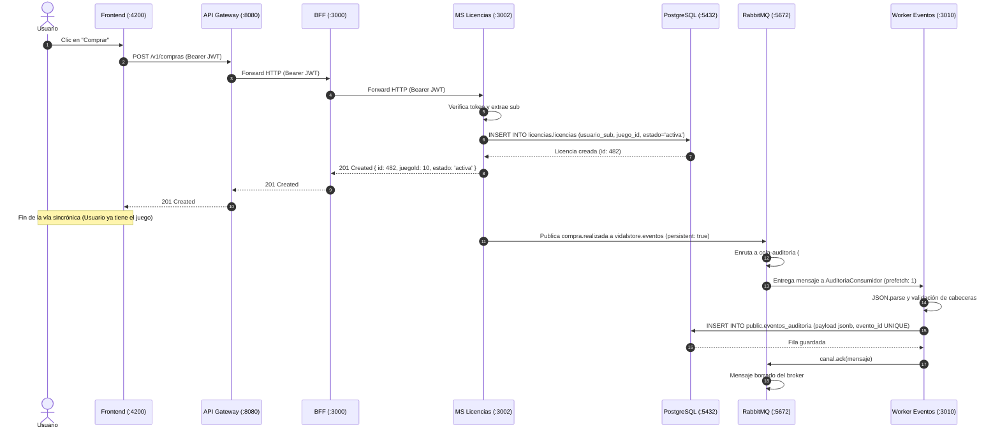

---

## 11. Flujo 10 · El Mensaje Envenenado y la Salida de Emergencia DLQ (L7)

> **Pregunta de Defensa:** _"¿Qué ocurre si se publica un mensaje que no es JSON o que tiene datos corruptos? Demuestra la ruta hacia la DLQ."_

> ⚡ **Resumen Técnico:** Un productor publica un mensaje con el cuerpo `{ esto no es JSON valido`. RabbitMQ lo entrega al consumidor. El consumidor ejecuta `JSON.parse(mensaje.content.toString())` dentro de un bloque `try/catch`. La excepción `SyntaxError` es interceptada por la función `esDelMensaje(error)`, la cual determina que es un error intrínseco del dato que reintentar jamás va a solucionar. El consumidor ejecuta inmediatamente `canal.nack(mensaje, false, false)`: el primer `false` indica que solo se descarta este mensaje, y el segundo `false` indica `requeue: false` (NO reencolar). Al tener la cola el argumento `x-dead-letter-exchange: vidalstore.dlx` y `x-dead-letter-routing-key: cola-auditoria`, RabbitMQ aparta el mensaje de la cola de trabajo y lo publica en el DLX direct, el cual lo deposita en `cola-auditoria.dlq`. RabbitMQ le inyecta el encabezado forense `x-death` con motivo `reason: "rejected"` y la routing key original. `CartasMuertasConsumidor` extrae el mensaje de la DLQ, parsea `x-first-death-queue` y lo inserta en la tabla `mensajes_muertos` (columna `payload text`), confirmando con `canal.ack(mensaje)`.

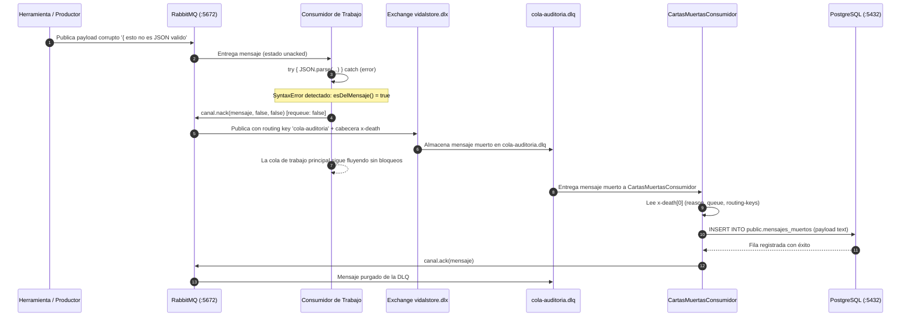

---

## 12. Flujo 11 · Resiliencia ante Caída de Base de Datos y Reintentos (L7)

> **Pregunta de Defensa:** _"¿Cómo distingue tu worker entre un error del mensaje y un fallo del entorno, y qué ocurre si PostgreSQL se detiene?"_

> ⚡ **Resumen Técnico:** Cuando el consumidor recibe un evento válido pero la base de datos PostgreSQL está inaccesible (ej: contenedor detenido, `getaddrinfo ENOTFOUND postgres`), la función `conReintentos` evalúa `esDelMensaje(error)`. Al detectar que el error no es de sintaxis ni de restricción relacional, no descarta el mensaje inmediatamente: mantiene el mensaje en estado `unacked` en memoria y reintenta la operación hasta un máximo de 3 veces aplicando un retroceso progresivo (*progressive backoff* de 2 segundos en el intento 1 y 4 segundos en el intento 2). Durante estos reintentos, gracias a `prefetch(1)`, el consumidor retiene ese único mensaje y no asume más carga. Si la base de datos se recupera durante la ventana de reintento, el `insert` triunfa y se envía `canal.ack(mensaje)`. Si se agotan los 3 intentos sin éxito, el consumidor ejecuta `canal.nack(mensaje, false, false)` enviándolo a la DLQ, evitando que la cola quede congelada indefinidamente.

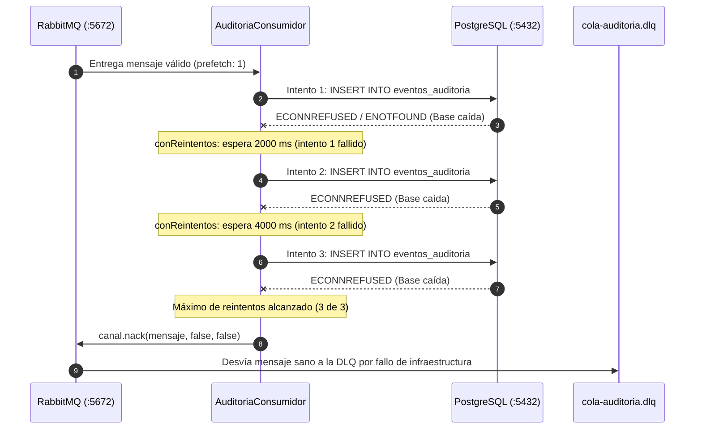

---

## 13. Flujo 12 · Idempotencia Real y Protección contra Duplicados 23505 (L7)

> **Pregunta de Defensa:** _"Si un mensaje se procesa dos veces debido a una reentrega de RabbitMQ, ¿cómo garantizas que no se dupliquen registros?"_

> ⚡ **Resumen Técnico:** La garantía de RabbitMQ es *at least once*. Si el consumidor guarda en PostgreSQL pero la red falla antes de enviar el `ack`, el mensaje vuelve a la cola y se reentrega con el mismo UUID en el header `x-evento-id`. Al intentar insertar por segunda vez, el motor de PostgreSQL detecta que el `evento_id` ya existe y rechaza el `INSERT` arrojando el código de error SQLSTATE `23505` (*unique_violation*). El bloque `catch` del consumidor inspecciona específicamente `error.code === '23505'`: no lanza excepción ni envía el mensaje a la DLQ; emite un log informativo (`reentrega del evento <uuid>: ya estaba guardado`) y ejecuta inmediatamente `canal.ack(mensaje)`. Así, la operación resulta completamente idempotente: procesar el evento una vez o diez veces deja la base de datos en el mismo estado exacto con `count(*) === 1`.

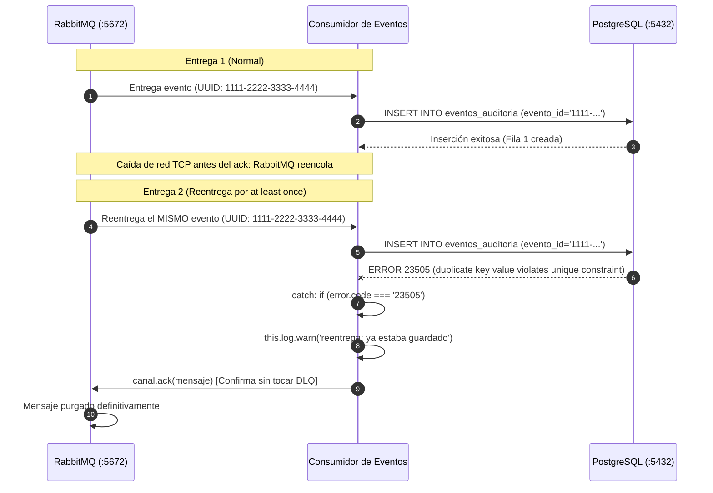


---

## 14. Flujo 13 · Gestión Administrativa y Observabilidad del Clúster (`vidalstore-admin` · IE6, IE7, IE8, IE17 e IE18)

> **Responsable:** Oscar Garrido · Microservicio Administrador en Puerto `3020`.  
> **Indicadores Cubiertos:** IE6 (Endpoints REST bien definidos), IE7 (Encapsulación en `RabbitAdminService`), IE8 (Validación estricta de DTOs), IE17 (Demostración administrativa en vivo) e IE18 (Explicación fundamentada de métricas).

> ⚡ **Resumen Técnico (Arquitectura de 2 Protocolos):** `vidalstore-admin` opera como un microservicio independiente de control operativo y observabilidad bajo el principio de Zero Trust. Valida tokens JWT asimétricos con la biblioteca `jose` contra las JWKS públicas de AWS Cognito y extrae la identidad inmutable del operador desde `req.user.sub` (prohibiendo suplantación por body). El acceso está estrictamente protegido a nivel de controlador con `AuthGuard` y `RolesGuard` (`@Roles('ADMIN', 'administradores')`), respondiendo `401 Unauthorized` si el token es ausente o inválido, y `403 Forbidden` si el usuario carece del rol administrativo.
> 
> A nivel de integración con RabbitMQ, `RabbitAdminService` implementa una **Arquitectura Híbrida de 2 Protocolos**:
> 1. **Protocolo HTTP Management API (`http://rabbitmq1:15672/api/*`):** Utilizado para observabilidad, consulta de métricas globales, inspección de topología y operaciones declarativas masivas (`definitions`). Consume respuestas JSON con autenticación básica (`guest:guest` o credenciales de operador).
> 2. **Protocolo Nativo AMQP 0-9-1 (`amqp://rabbitmq1:5672`):** Utilizado para operaciones transaccionales de bajo nivel, remediación de colas, publicaciones administrativas con confirmación (`confirmChannel`) y el reprocesamiento controlado de cartas muertas hacia `vidalstore.dlx`.

### 14.1 Patrón de Canal Efímero y Aislamiento de Fallos en `RabbitAdminService` (IE7)

Para evitar que una falla operativa en una cola destruya el microservicio, `RabbitAdminService` aplica el **Patrón de Canal Efímero por Operación con Captura Inmediata de Errores**:
* Mantiene una **única conexión TCP persistente** (`amqplib.Connection`) compartida a nivel de módulo inyectada en el ciclo de vida de NestJS (`OnModuleInit`).
* Por cada petición HTTP recibida en el controlador, crea un **canal efímero** exclusivo (`await this.connection.createChannel()`).
* **Regla Crítica de Resiliencia:** Inmediatamente después de instanciar el canal, se registra un listener de captura de errores:
  ```typescript
  const canal = await this.connection.createChannel();
  canal.on('error', (err) => {
    this.logger.warn(`Canal efímero cerrado por RabbitMQ: ${err.message}`);
  });
  ```
  *Justificación Técnica:* En `amqplib`, si una operación viola una precondición (ej. declarar una cola con durabilidad distinta a la existente), RabbitMQ emite un cierre de canal a nivel de protocolo y dispara un evento `'error'`. Si este evento no tiene un listener registrado de inmediato, Node.js lo trata como un error no capturado (*uncaught exception*) y aborta el proceso completo. Con este patrón, el error queda confinado al canal efímero, el cual se destruye limpiamente en el bloque `finally` con `await canal.close().catch(() => undefined)` sin comprometer la conexión global ni otros hilos de ejecución.

### 14.2 Mapeo Semántico de Errores con `traducir(err)` y DTOs Estrictos (IE8)

Toda excepción capturada en el servicio es traducida a respuestas semánticas REST de NestJS mediante la función auxiliar `traducir(err)`:

| Error AMQP / Causa Raíz | Código de Error | Excepción NestJS | Código HTTP Resultante |
|---|---|---|:---:|
| Cola o Exchange no encontrado | `NOT_FOUND` / 404 en Mgmt API | `NotFoundException` | `404 Not Found` |
| Argumentos incompatibles / Durabilidad cruzada | `PRECONDITION_FAILED` / 406 | `ConflictException` | `409 Conflict` |
| Quórum Raft caído / Broker desconectado | `ECONNREFUSED` / Timeout / Minority | `ServiceUnavailableException` | `503 Service Unavailable` |
| DTO con propiedades extrañas o tipos inválidos | Violación `class-validator` | `BadRequestException` | `400 Bad Request` |

> 🛡️ **Validación Estricta:** La aplicación aplica `ValidationPipe({ whitelist: true, forbidNonWhitelisted: true })`. Si el cliente envía atributos no declarados en el DTO (ej. `invalido: 123`), NestJS rechaza la petición en el perímetro con `400 Bad Request` indicando la propiedad prohibida.

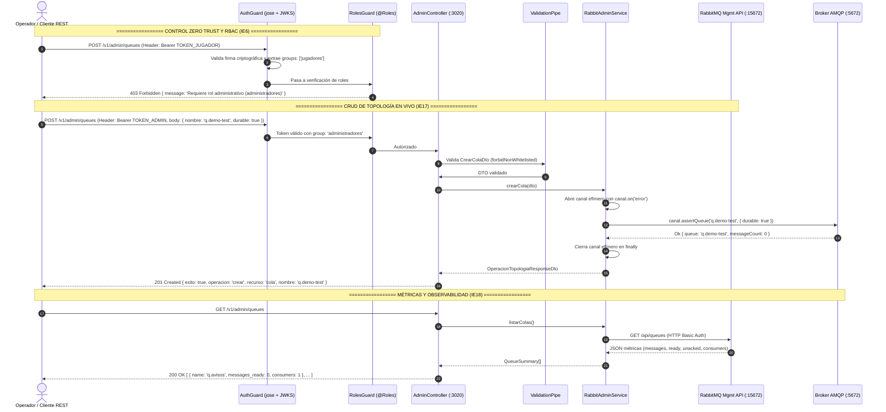

### 14.3 Batería de 8 Pruebas cURL de Verificación Rápida (Tramo 2 y Tramo 5)

Durante la evaluación en vivo, se ejecutan las siguientes 8 pruebas en terminal para verificar el cumplimiento funcional del microservicio:

```bash
# 1. Crear cola válida (201 Created)
curl -s -X POST http://localhost:3020/v1/admin/queues \
  -H "Authorization: Bearer $TOKEN_ADMIN" -H "Content-Type: application/json" \
  -d '{"nombre":"q.prueba-l8","durable":true}' | jq .

# 2. Inyección de campo prohibido (400 Bad Request por forbidNonWhitelisted)
curl -s -w "\nHTTP: %{http_code}\n" -X POST http://localhost:3020/v1/admin/queues \
  -H "Authorization: Bearer $TOKEN_ADMIN" -H "Content-Type: application/json" \
  -d '{"nombre":"q.test-invalida","campoProhibido":true}'

# 3. Conflicto de precondición (409 Conflict por discrepancia durable/quorum)
curl -s -w "\nHTTP: %{http_code}\n" -X POST http://localhost:3020/v1/admin/queues \
  -H "Authorization: Bearer $TOKEN_ADMIN" -H "Content-Type: application/json" \
  -d '{"nombre":"q.avisos","durable":false}'

# 4. Listar colas y métricas operativas en vivo (200 OK)
curl -s http://localhost:3020/v1/admin/queues \
  -H "Authorization: Bearer $TOKEN_ADMIN" | jq '.[0:3]'

# 5. Obtener detalle de cola existente (200 OK) e inexistente (404 Not Found)
curl -s http://localhost:3020/v1/admin/queues/q.avisos -H "Authorization: Bearer $TOKEN_ADMIN" | jq .
curl -s -w "\nHTTP: %{http_code}\n" http://localhost:3020/v1/admin/queues/q.no-existe -H "Authorization: Bearer $TOKEN_ADMIN"

# 6. Eliminar cola de prueba (200 OK y posterior 404)
curl -s -X DELETE http://localhost:3020/v1/admin/queues/q.prueba-l8 -H "Authorization: Bearer $TOKEN_ADMIN" | jq .
curl -s -w "\nHTTP: %{http_code}\n" -X DELETE http://localhost:3020/v1/admin/queues/q.prueba-l8 -H "Authorization: Bearer $TOKEN_ADMIN"

# 7. Crear Exchange y Binding (201 Created)
curl -s -X POST http://localhost:3020/v1/admin/exchanges \
  -H "Authorization: Bearer $TOKEN_ADMIN" -H "Content-Type: application/json" \
  -d '{"nombre":"ex.prueba-l8","tipo":"topic","durable":true}' | jq .
curl -s -X POST http://localhost:3020/v1/admin/bindings \
  -H "Authorization: Bearer $TOKEN_ADMIN" -H "Content-Type: application/json" \
  -d '{"exchange":"ex.prueba-l8","cola":"q.avisos","routing_key":"prueba.#"}' | jq .

# 8. Reprocesamiento controlado de carta muerta con Idempotencia (200 OK y posterior 400)
curl -s -X POST http://localhost:3020/v1/admin/dlq/77777777-7777-4777-a777-777777777777/reproceso \
  -H "Authorization: Bearer $TOKEN_ADMIN" | jq .
curl -s -w "\nHTTP: %{http_code}\n" -X POST http://localhost:3020/v1/admin/dlq/77777777-7777-4777-a777-777777777777/reproceso \
  -H "Authorization: Bearer $TOKEN_ADMIN"
```

### 14.4 Interpretación de Métricas Clave para la Defensa (IE18)

Durante la presentación técnica, el estudiante debe demostrar y explicar en vivo los valores expuestos por `GET /v1/admin/queues`:

| Métrica en JSON | Significado Técnico | Interpretación Operativa y Diagnóstico de Anomalías |
|---|---|---|
| **`messages_ready`** | Mensajes listos en cola esperando entrega a un consumidor disponible. | Si este valor crece sostenidamente, indica que la tasa de publicación supera la capacidad de procesamiento de los consumidores, o que el consumidor correspondiente está caído (`consumers: 0`). |
| **`messages_unacknowledged`** (`unacked`) | Mensajes entregados a los consumidores que aún no han recibido `ack` ni `nack`. | Si este valor se estanca en el límite del `prefetch` (ej. 1), indica que el consumidor está bloqueado en una transacción lenta de PostgreSQL, en un bucle de reintentos o que ocurrió una caída de red antes de confirmar. |
| **`consumers`** | Cantidad de canales AMQP con suscripción activa (`basic.consume`) sobre la cola. | Si es `0`, la cola no tiene quién procese sus eventos. En VidalStore debe ser al menos `1` para `q.avisos`, `q.auditoria` y `q.correos`. |
| **`messages`** | Total acumulado en la cola (`messages_ready + messages_unacknowledged`). | Métrica global de saturación utilizada para evaluar alarmas de retención de memoria y políticas de desborde (`overflow`). |
| **Cartas en `dlq.*`** | Mensajes rechazados sin reencolar (`nack(false, false)`). | Indica fallas funcionales (mensajes mal formados o veneno) o agotamiento de reintentos por caída prolongada de infraestructura. |

---

## 15. Flujo 14 · Reprocesamiento Controlado de Cartas Muertas desde DLQ (Requisito Grupos de 3)

> **Requisito Obligatorio:** Grupos de 3 integrantes (David, Oscar e Iván).  
> **Endpoint:** `POST /v1/admin/dlq/:id/reproceso` en `vidalstore-admin` (:3020).

> ⚡ **Resumen Técnico:** Cuando un mensaje envenenado aterriza en una DLQ y es registrado en la tabla `mensajes_muertos` de PostgreSQL, queda en estado de cuarentena forense. Tras corregir la causa raíz (ej. restablecer PostgreSQL o desplegar un parche de software), el administrador inicia un reprocesamiento controlado vía `POST /v1/admin/dlq/:id/reproceso`. El microservicio valida que el identificador sea un UUID v4 válido (`ParseUUIDPipe`), consulta la base de datos y verifica idempotencia: si la columna `reprocesada` ya es `true`, aborta con `400 Bad Request`. Si está pendiente, republica el payload original hacia `vidalstore.dlx` con routing key `dlq.reprocesar` (`persistent: true`) inyectando metadatos de trazabilidad (`x-reprocesado-por`, `x-reprocesado-en`, `x-mensaje-muerto-id`), y actualiza la fila en PostgreSQL con `reprocesada = true`, `reprocesado_por = adminSub` y marca de tiempo.

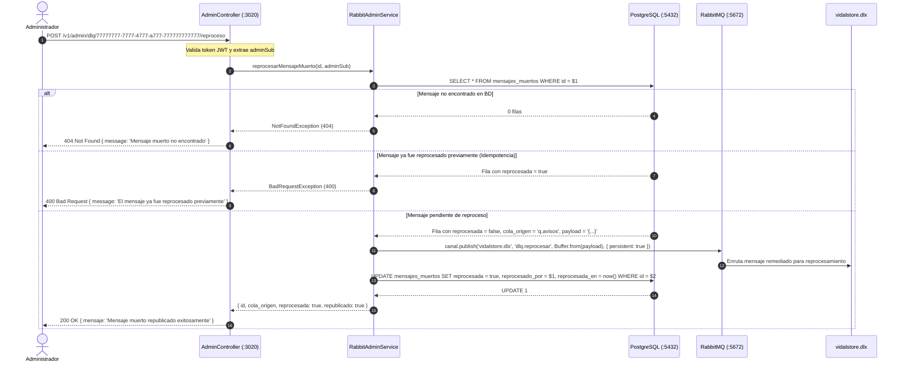

### 15.1 Respuestas Semánticas y Pruebas Unitarias Vitest
El microservicio cuenta con cobertura unitaria total del flujo en `rabbit-admin.service.spec.ts`:
* **Caso Éxito (`200 OK`)**: Retorna `{ reprocesada: true, republicado: true, routing_key_reproceso: 'dlq.reprocesar' }`.
* **Idempotencia (`400 Bad Request`)**: Si se invoca dos veces con el mismo UUID, la segunda llamada es rechazada protegiendo la base de datos de reprocesamientos accidentales.
* **UUID Mal Formado (`400 Bad Request`)**: `ParseUUIDPipe` corta la petición en el perímetro si el parámetro no es un UUID válido.
* **No Existe (`404 Not Found`)**: Si el UUID no figura en `mensajes_muertos`.
* **Base Caída (`503 Service Unavailable`)**: Si PostgreSQL está apagado, atrapa el fallo y responde 503 descriptivo.

---

## 16. Flujo 15 · Clúster RabbitMQ 2 Nodos, Failover y el Estado Minority (IE9, IE10, IE11)

> **Responsable:** David · Repositorio `vidalstore-plataforma`.  
> **Indicadores Cubiertos:** IE9 (Dos nodos RabbitMQ), IE10 (Clúster de 2 nodos con análisis de partición) e IE11 (Docker Compose con healthcheck condicionado).

> ⚡ **Resumen Técnico y Quórum Raft:** La infraestructura de mensajería está orquestada con Docker Compose (`docker-compose.yml`) levantando dos nodos de RabbitMQ 4.3 (`rabbitmq1` en `:5672/:15672` y `rabbitmq2` en `:5673/:15673`). Ambos nodos comparten la misma cookie criptográfica (`RABBITMQ_ERLANG_COOKIE`) y utilizan descubrimiento estático de pares (`classic_config` en `rabbitmq/rabbitmq.conf`). Para garantizar un arranque sin carreras, `rabbitmq2` depende de `rabbitmq1` mediante `condition: service_healthy`, validado con `rabbitmq-diagnostics check_running`.
> 
> En RabbitMQ 4, los metadatos del clúster y las colas Quorum se gestionan mediante el algoritmo de consenso **Raft** (Khepri). Bajo Raft, la formación de quórum exige una mayoría estricta gobernada por la fórmula matemática:
> $$\text{Mayoría Requerida} = \left\lfloor \frac{N}{2} \right\rfloor + 1$$
> Para un clúster de $N=2$ nodos:
> $$\left\lfloor \frac{2}{2} \right\rfloor + 1 = 1 + 1 = 2$$
> Por lo tanto, **un clúster de 2 nodos soporta exactamente 0 caídas para operaciones de consenso**. Si `rabbitmq2` se detiene, el nodo sobreviviente se queda con 1 nodo disponible ($1 < 2$), entrando de inmediato en estado **`minority`**.

### 16.1 Diagnóstico Crítico: Discrepancia entre CLI y Management API

Durante la simulación de failover, se produce una discrepancia diagnóstica fundamental que debe explicarse ante la comisión:
* **En CLI local (`rabbitmqctl list_queues state`):** En el nodo local `rabbitmq1`, las colas clásicas pueden seguir reportando estado `running` porque su proceso Erlang local sigue activo.
* **En Management API (`GET /api/queues`):** Las colas de quórum (*Quorum Queues*) reportan explícitamente estado **`minority`**.

### 16.2 Publisher Confirms vs Buffer de Socket (`sendToQueue`)
Si una aplicación publica a una cola Quorum en estado `minority`:
* Si usa `sendToQueue()` **sin confirmaciones de publicación**, la función retorna engañosamente `true` porque solo indica que los bytes entraron al buffer del socket TCP local.
* Si usa un canal con confirmaciones (`confirmChannel`), la llamada entra en espera y aborta por **`confirm_timeout`** tras vencer el temporizador, ya que el líder Raft no puede obtener el voto de la mayoría para confirmar la escritura en disco.

### 16.3 Comando Diagnóstico de Quórum Crítico
Para verificar si un nodo es indispensable para mantener el quórum antes de apagarlo:
```bash
docker exec vidalstore-rabbitmq1 rabbitmq-diagnostics check_if_node_is_quorum_critical
```
Si detener el nodo dejaría al clúster sin mayoría, el comando termina con **Código de Salida 69**, advirtiendo que el nodo es crítico.

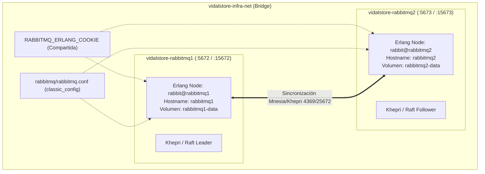

### 16.4 El Guion de Resiliencia del Clúster (`rabbitmq-cluster-test.sh`)
Para demostrar IE10 durante la defensa:
1. **Comprobar clúster sano**:
   ```bash
   docker exec vidalstore-rabbitmq1 rabbitmq-diagnostics cluster_status
   ```
   Muestra `Running Nodes: [rabbit@rabbitmq1, rabbit@rabbitmq2]` con alarmas en `false`.
2. **Provocar caída de nodo 2**:
   ```bash
   docker stop vidalstore-rabbitmq2
   ```
3. **Verificar comportamiento de nodo 1**:
   La sonda `scripts/sonda-cluster.ts` demuestra que `rabbitmq1` sigue respondiendo lecturas pero advierte la pérdida del quórum de 2 nodos (`minority`).
4. **Recuperación y Re-sincronización**:
   ```bash
   docker start vidalstore-rabbitmq2
   ```
   Los dos nodos restablecen la conexión en segundos sin pérdida de mensajes ni alteración de las colas durables.

> 🎓 **Argumento Oficial de Defensa:** "¿Por qué usamos 2 nodos si no otorgan alta disponibilidad tolerante a fallos? Descartamos 1 nodo porque no valida clustering ni replicación física; descartamos 3 nodos por restricción de recursos en los laboratorios evaluados. 2 nodos demuestran durabilidad física desacoplada entre discos y reconexión automática sin split-brain, asumiendo conscientemente que la tolerancia activa a fallos exige $\ge 3$ nodos impares."

---

## 17. Flujo 16 · Políticas de Retención, Limpieza y Desborde (IE19)

> **Responsable:** David · Repositorio `vidalstore-plataforma`.  
> **Indicador Cubierto:** IE19 (Políticas de retención, límites y expiración).

> ⚡ **Resumen Técnico:** Si las colas crecen indefinidamente sin control, consumen la memoria RAM del contenedor activando la alarma de memoria de RabbitMQ, lo que congela todas las publicaciones del clúster. Para evitarlo, se aplican **políticas dinámicas** mediante `rabbitmqctl set_policy` y se versionan declarativamente en el repositorio en `rabbitmq/politicas.json` para ser importadas automáticamente mediante `import_definitions`.
> 
> Definir límites mediante políticas es técnicamente superior a codificarlos como argumentos `x-*` en `topologia.ts`: si un argumento de cola cambia en el código, RabbitMQ rechaza la conexión con `406 PRECONDITION_FAILED` obligando a destruir y recrear la cola; en cambio, las políticas se actualizan en caliente en el broker sin desconectar servicios ni perder mensajes.

### 17.1 Matriz Oficial de Políticas de Retención

| Política | Patrón Regex | Colas Afectadas | `max-length` | `max-length-bytes` | `overflow` | `message-ttl` | Justificación Técnica de Negocio |
|---|---|---|:---:|:---:|:---:|:---:|---|
| **`retencion-notificaciones`** | `^q\.(avisos\|correos)$` | `q.avisos`<br>`q.correos` | 10.000 | 20 MiB | `drop-head` | 1 hora (`3600000`) | **Notificaciones efímeras.** Un aviso de compra o correo que tarda horas en llegar pierde su utilidad. Si la cola se desborda, `drop-head` expulsa el mensaje más antiguo y lo deriva a su DLQ con motivo `maxlen`. |
| **`retencion-auditoria`** | `^q\.auditoria$` | `q.auditoria` | 50.000 | 100 MiB | `drop-head` | 24 horas (`86400000`) | **Registro de cumplimiento legal.** No pierde valor. Un TTL de 24 horas actúa como **sonda de detección de anomalías**: si un evento pasa 24 horas sin consumirse, se desvía a `dlq.auditoria` (motivo `expired`) para alertar que el worker está atascado. |
| **`retencion-dlq`** | `^dlq\.(avisos\|auditoria\|correos)$` | `dlq.avisos`<br>`dlq.auditoria`<br>`dlq.correos` | 250.000 | 500 MiB | `reject-publish` | 14 días (`1209600000`) | **Evidencia forense.** Prohibido usar `drop-head` en DLQ: borraría silenciosamente los errores más antiguos. `reject-publish` preserva las cartas muertas acumuladas para análisis y reprocesamiento humano. |

### 17.2 Matices Críticos de Implementación en RabbitMQ 4
1. **Comportamiento de Quorum Queues con `reject-publish`:** Debido al pipeline de replicación del log Raft en RabbitMQ 4, las Quorum Queues permiten que ingrese exactamente **+1 mensaje** por encima de `max-length` antes de rechazar formalmente las siguientes publicaciones.
2. **No-retroactividad del TTL en Colas Clásicas:** Si se aplica una política con `message-ttl` a una cola que ya contiene mensajes viejos acumulados, RabbitMQ no los descarta inmediatamente en masa; el temporizador se evalúa a medida que los mensajes alcanzan la cabeza de la cola para ser entregados o cuando ingresan nuevos mensajes.

---

## 18. Protocolo de Defensa en Vivo y Framework Verbal (El Reloj de 15 Minutos de D6)

La defensa técnica ante la comisión evaluadora (profesor Umbingelelo) tiene una duración estricta de **15 minutos cronometrados**. Para aprobar con la máxima calificación y responder con solvencia técnica, el equipo debe dominar 3 pilares operativos fundamentales:
1. **El Reloj de 15 Minutos:** Gestión del tiempo dividida en 4 fases cronometradas.
2. **Las 5 Ventanas Obligatorias:** Preparación visual del entorno antes de iniciar la evaluación.
3. **El Framework Verbal en 4 Pasos:** Estructura de respuesta de 60 segundos para neutralizar cualquier pregunta del docente o defender la **"Modificación Señalada"**.

---

### 18.1 El Reloj de 15 Minutos (Cronograma Oficial D6 y EP2)

| Minutos | Fase Operativa | Objetivo Principal | Acciones Técnicas y Comandos Clave |
|---|---|---|---|
| **00:00 – 03:00** | **Fase 1: Verificación de Entorno y Procesos** | Demostrar que toda la infraestructura levantó sin errores ni colisiones de puertos. | • Ejecutar `docker compose ps` en `vidalstore-plataforma`.<br/>• Confirmar que todos los contenedores reportan estado `Up (healthy)`.<br/>• Verificar el mapa de puertos expuestos:<br/>  - Gateway: `:8080` \| BFF: `:3001` \| Catálogo: `:3002`<br/>  - Compras: `:3003` \| Biblioteca: `:3004` \| Admin: `:3020`<br/>  - RabbitMQ1: `:5672`/`:15672` \| RabbitMQ2: `:5673`/`:15673`<br/>  - PostgreSQL: `:5432` \| Frontend Angular: `:4200` |
| **03:00 – 09:00** | **Fase 2: Recorrido de los 11 Pasos Oficiales (§5.1)** | Demostrar la topología AMQP, mensajería asíncrona, resiliencia y persistencia. | • Recorrer los 11 pasos cronológicos de la pauta (§5.1).<br/>• Mostrar topología en RabbitMQ UI (`vidalstore.eventos`, `vidalstore.comandos`, `vidalstore.dlx`, las 3 colas y sus 3 DLQs con `x-dead-letter-*`).<br/>• Disparar evento asíncrono y mostrar log en `vidalstore-eventos`.<br/>• Evidenciar persistencia relacional en PostgreSQL (`eventos_auditoria`, `mensajes_muertos`).<br/>• Demostrar observabilidad en `vidalstore-admin` (`GET /v1/admin/queues`). |
| **09:00 – 12:00** | **Fase 3: La "Modificación Señalada" (D6)** | Responder a la prueba sorpresa en vivo exigida por el profesor Umbingelelo. | • Mantener la serenidad y estructurar la respuesta con el Framework de 4 Pasos antes de escribir en la terminal.<br/>• Ejecutar la prueba específica pedida por el docente (ver matriz de casos típicos en §18.2).<br/>• Comprobar el resultado en vivo sin reiniciar servicios a ciegas. |
| **12:00 – 15:00** | **Fase 4: Cierre y Compra de Punta a Punta** | Concluir la evaluación demostrando la interacción completa de usuario y responder preguntas finales. | • En el navegador Angular (`:4200`), presionar el botón "Comprar".<br/>• Verificar la cadena completa: Angular → Gateway → BFF → Compras → RabbitMQ → Worker → PostgreSQL.<br/>• Inspeccionar métricas finales del clúster y resolver consultas de la comisión. |

---

### 18.2 La "Modificación Señalada": Cómo Afrontar la Prueba Sorpresa en Vivo

> ⚡ **¿Qué es la "Modificación Señalada"?** En la clase D6 ("Git en serio") y en las directrices de evaluación, se establece que el profesor Umbingelelo seleccionará al azar una alteración imprevista del sistema durante la defensa para corroborar que el equipo comprende la arquitectura y no está siguiendo una demostración prefabricada.

#### Matriz de Casos Típicos de Modificación Señalada:

1. **Prueba de Tolerancia y Failover de Clúster (IE10):**
   * *Pregunta del profesor:* "Bota el nodo 2 de RabbitMQ y demuéstrame qué ocurre con el clúster y las colas".
   * *Acción:* Ejecutar `docker stop vidalstore-rabbitmq2`.
   * *Explicación técnica:* El clúster pierde el quórum Raft (⌊2/2⌋ + 1 = 2). El nodo 1 entra en estado `minority`. Sigue sirviendo colas existentes pero rechaza cambios de topología para impedir *split-brain*. Al ejecutar `docker start vidalstore-rabbitmq2`, los nodos se sincronizan en segundos vía Erlang Cookie sin perder mensajes.
2. **Prueba del Mensaje Envenenado y DLQ (IE16):**
   * *Pregunta del profesor:* "Inyecta un mensaje malformado a la cola y muéstrame cómo reacciona el consumidor".
   * *Acción:* Publicar un JSON roto o sin UUID obligatorio vía Swagger de `vidalstore-admin` o `rabbitmqadmin`.
   * *Explicación técnica:* El worker valida el esquema, detecta el fallo fatal y emite `channel.nack(msg, false, false)` sin requeue. El broker enruta el mensaje a `vidalstore.dlx`, este llega a la DLQ correspondiente y el consumidor de cartas muertas lo guarda en la tabla `mensajes_muertos` preservando el encabezado `x-death`.
3. **Prueba de Políticas de Retención en Caliente (IE19):**
   * *Pregunta del profesor:* "Cambia el límite de una cola a 5 mensajes con descarte `reject-publish` sin reiniciar el contenedor".
   * *Acción:* `docker exec vidalstore-rabbitmq1 rabbitmqctl set_policy limite-test "^q\.avisos$" '{"max-length":5, "overflow":"reject-publish"}' --apply-to queues`.
   * *Explicación técnica:* Las políticas dinámicas se actualizan en memoria del broker sin requerir desconexión ni arrojar error `406 PRECONDITION_FAILED` (lo que sí ocurriría si se usaran argumentos `x-*` en TypeScript).
4. **Prueba de Idempotencia y Concurrencia (IE12 / L7):**
   * *Pregunta del profesor:* "Envía el mismo evento dos veces al worker. ¿Qué pasa en PostgreSQL?".
   * *Acción:* Inyectar el mismo payload con el mismo UUID/clave dos veces consecutivas.
   * *Explicación técnica:* La restricción `UNIQUE` en PostgreSQL dispara el error de violación de clave única `23505`. El worker intercepta explícitamente el código `23505`, confirma el mensaje con `ack` (porque el efecto ya existía) y no arroja una excepción 500 no controlada.
5. **Prueba de Control de Acceso y Roles (IE8):**
   * *Pregunta del profesor:* "Intenta crear una cola en `vidalstore-admin` usando un token de cliente común".
   * *Acción:* Enviar `POST /v1/admin/queues` con token sin grupo `ADMIN`.
   * *Explicación técnica:* El `RolesGuard` intercepta la petición, verifica que el claim `cognito:groups` no contiene `ADMIN` y retorna de inmediato `403 Forbidden` antes de tocar la capa de mensajería.

---

### 18.3 Las 5 Ventanas Obligatorias Abiertas en Pantalla

Para no perder tiempo abriendo herramientas durante los 15 minutos, el equipo debe tener preparadas en sus monitores o proyector las siguientes 5 ventanas:

| Ventana | Ubicación / URL | Vista en Pantalla | Propósito en la Demostración |
|:---:|---|---|---|
| **1** | **Terminal Docker / Host** (`vidalstore-plataforma`) | Terminal dividida con `docker compose ps` y lista para ejecutar `rabbitmqctl cluster_status` o `docker stop`. | Demostrar orquestación, puertos y ejecutar la Modificación Señalada en segundos. |
| **2** | **RabbitMQ Management UI** | Navegador con `http://localhost:15672` (rabbit1) y pestaña contigua `http://localhost:15673` (rabbit2). | Mostrar clúster sano, los 2 exchanges (`topic` y `direct`), las 3 colas y sus 3 DLQs con argumentos `dlx`. |
| **3** | **Terminal de Logs del Worker** (`vidalstore-eventos`) | Terminal con streaming de logs en vivo (`docker compose logs -f worker-eventos` o `npm run start:dev`). | Demostrar en tiempo real la recepción de eventos, los `ack`, los rechazos `nack(false, false)` y la persistencia en base de datos. |
| **4** | **Swagger UI de `vidalstore-admin`** | Navegador en `http://localhost:3020/api/docs` (o cliente HTTP Postman). | Demostrar el CRUD de colas/exchanges/bindings, métricas del clúster (`GET /v1/admin/queues`), validación DTO 400 y endpoint de reprocesamiento DLQ. |
| **5** | **Frontend Angular / DevTools** | Navegador en `http://localhost:4200` con consola DevTools abierta en pestañas *Network* y *Application* (`sessionStorage`). | Demostrar la autenticación Cognito con PKCE, catálogo con scopes, compra interactiva y verificación BOLA/IDOR. |

---

### 18.4 Framework de Defensa Verbal en 4 Pasos (Estructura de 1 Minuto)

Cuando el profesor Umbingelelo te ponga el cursor sobre un bloque de código o te formule una pregunta conceptual, estructura tu respuesta en **exactamente 60 segundos** siguiendo este orden:

```
┌────────────────────────────────────────────────────────────────────────┐
│ PASO 1: QUÉ HICE                                                       │
│ "En [archivo/módulo], implementé [clase/función/configuración]..."     │
├────────────────────────────────────────────────────────────────────────┤
│ PASO 2: QUÉ PROBLEMA RESUELVE                                          │
│ "Esto resuelve [requisito de negocio / criterio de rúbrica / falla]..."│
├────────────────────────────────────────────────────────────────────────┤
│ PASO 3: QUÉ DESCARTÉ (El argumento que más califica)                   │
│ "Descarté [alternativa rechazada] porque [motivo técnico concreto]..." │
├────────────────────────────────────────────────────────────────────────┤
│ PASO 4: CÓMO LO COMPRUEBO                                              │
│ "Lo demuestro aquí en pantalla con [métrica / log / status / test]..." │
└────────────────────────────────────────────────────────────────────────┘
```

---

### 18.5 Catálogo Maestro de Respuestas Verbales Listas para la Defensa

#### Caso A (EP1): Resolución de Biblioteca por `sub` (Seguridad BOLA/IDOR)
1. **Qué hice:** En `bff-biblioteca.controller.ts`, inyecté el claim `sub` usando el decorador personalizado `@CurrentUser('sub')`.
2. **Qué problema resuelve:** Erradica vulnerabilidades BOLA/IDOR (OWASP API Security Top 1). Ningún jugador puede suplantar la identidad de otro para ver o modificar su biblioteca.
3. **Qué descarté:** Descarté recibir el `userId` como parámetro de ruta o query (`/biblioteca?userId=xxx`).
4. **Cómo lo compruebo:** Muestro en la pestaña Red que Angular solo invoca `GET /v1/biblioteca` sin parámetros y el backend extrae criptográficamente la identidad desde el JWT verificado por JWKS.

#### Caso B (EP1): Persistencia en `sessionStorage` (Eliminación de Hallazgo Forense)
1. **Qué hice:** En `main.ts` de Angular, configuré `cognitoUserPoolsTokenProvider.setKeyValueStorage(sessionStorage)`.
2. **Qué problema resuelve:** Protege los tokens de accesos no autorizados post-sesión. Al cerrar la pestaña o navegador, el token se destruye de la memoria.
3. **Qué descarté:** Descarté `localStorage` (hallazgo forense de la auditoría) y cookies sin atributos `HttpOnly`/`Secure`.
4. **Cómo lo compruebo:** Abro la pestaña *Application* en DevTools y demuestro que `Session Storage` contiene los tokens de Cognito, mientras `Local Storage` se encuentra completamente vacío.

#### Caso C (EP1): Agregación en el BFF con `Promise.all` (Concurrencia)
1. **Qué hice:** En `bff-biblioteca.controller.ts`, ejecuté `Promise.all` para consultar concurrentemente al microservicio de Biblioteca y Catálogo.
2. **Qué problema resuelve:** Reduce la latencia global al tiempo del servicio más lento ($\max(T_1, T_2)$ en lugar de $T_1 + T_2$) y evita la sobrecarga de red en el cliente (*chattiness*).
3. **Qué descarté:** Descarté llamadas secuenciales con `await` encadenados y descarté que Angular hiciera peticiones separadas a múltiples microservicios.
4. **Cómo lo compruebo:** Inspecciono la pestaña Red para demostrar que el navegador hace un único viaje HTTP y recibe el JSON cruzado en milisegundos.

#### Caso D (EP2): Clúster RabbitMQ de 2 Nodos y Quórum Raft (IE9, IE10, IE11)
1. **Qué hice:** Orquesté dos nodos RabbitMQ 4.3 (`rabbitmq1` y `rabbitmq2`) con cookie compartida y descubrimiento estático `classic_config`.
2. **Qué resuelve:** Sincronización automática de topología y distribución de conexiones en dos puertos independientes.
3. **Qué descarté:** Descarté afirmar que 2 nodos ofrecen alta disponibilidad tolerante a fallos. Descarté configuraciones sin quórum Raft. En Raft la mayoría requerida es ⌊N/2⌋ + 1; para N=2, la mayoría es 2. Por tanto, 2 nodos toleran **cero particiones**.
4. **Cómo lo compruebo:** Ejecuto `docker stop vidalstore-rabbitmq2` y muestro con `rabbitmqctl cluster_status` que `rabbit1` entra en estado `minority`, bloqueando cambios de topología para proteger la consistencia de datos.

#### Caso E (EP2): Cartas Envenenadas y DLQ: `nack(false, false)` vs `nack(false, true)` (IE13, IE16)
1. **Qué hice:** En el consumidor worker de `vidalstore-eventos`, ante un mensaje malformado ejecuté `channel.nack(msg, false, false)` sin requeue.
2. **Qué resuelve:** Desvía el mensaje corrupto inmediatamente al dead letter exchange (`vidalstore.dlx`), salvaguardando la cola principal.
3. **Qué descarté:** Descarté `nack(msg, false, true)` con requeue, ya que causaría un ciclo infinito (*poison message loop*) que satura la CPU del worker reintentando un mensaje destinado a fallar.
4. **Cómo lo compruebo:** Publico un mensaje corrupto: la consola del worker registra el error una sola vez y la cola `dlq.auditoria` incrementa en +1 mientras `q.auditoria` vuelve a cero.

#### Caso F (EP2): Idempotencia Relacional SQLSTATE 23505 vs Anti-Patrón TOCTOU (IE12 / L7)
1. **Qué hice:** Definí una restricción única en PostgreSQL (`UQ_usuario_juego`) y envolví la inserción capturando el código de error `23505` de PostgreSQL.
2. **Qué resuelve:** Garantiza idempotencia atómica en concurrencia real, evitando duplicados ante compras simultáneas.
3. **Qué descarté:** Descarté el anti-patrón TOCTOU (*Time-of-Check to Time-of-Use*) consistente en hacer un simple `findOne()` antes del insert, el cual falla bajo carreras concurrentes.
4. **Cómo lo compruebo:** Disparo dos peticiones de compra idénticas en paralelo; la primera inserta el registro y la segunda es capturada con código `23505` y confirmada con `ack` sin duplicar filas en la tabla `licencias`.

#### Caso G (EP2): Políticas Dinámicas de Retención vs Argumentos Hardcodeados (IE19)
1. **Qué hice:** Apliqué políticas de retención (`max-length`, `drop-head` y `reject-publish`) mediante `rabbitmqctl set_policy`.
2. **Qué resuelve:** Control de memoria RAM y desbordes configurable en caliente sin reiniciar el broker.
3. **Qué descarté:** Descarté configurar argumentos `x-max-length` en el código TypeScript (`topologia.ts`), ya que cualquier cambio posterior obliga a destruir y recrear las colas arrojando `406 PRECONDITION_FAILED`.
4. **Cómo lo compruebo:** Ejecuto `rabbitmqctl list_policies` y verifico que las 3 políticas (`retencion-notificaciones`, `retencion-auditoria`, `retencion-dlq`) están activas sobre sus patrones regex.

#### Caso H (EP2): Arquitectura Zero Trust y `RolesGuard` en `vidalstore-admin` (IE8, IE17)
1. **Qué hice:** Protegí los endpoints administrativos con `JwtAuthGuard` y `RolesGuard` verificando el claim `cognito:groups` con valor `ADMIN`.
2. **Qué resuelve:** Impide que usuarios autenticados con rol cliente o atacantes externos puedan alterar la topología del broker o publicar eventos privilegiados.
3. **Qué descarté:** Descarté delegar la seguridad únicamente al API Gateway o permitir acceso anónimo en la red interna.
4. **Cómo lo compruebo:** Envío una petición `POST /v1/admin/queues` con un token sin grupo `ADMIN` y demuestro que responde `403 Forbidden` con cuerpo JSON descriptivo.

---

## 19. Guion Oficial de la Demostración en Vivo de 11 Pasos de la EP2 (§5.1)

Durante la defensa técnica grupal e individual (15 minutos cronometrados), la comisión evalúa el sistema en vivo recorriendo estrictamente este orden cronológico:

| Paso Oficial (§5.1) | Qué se Muestra en Pantalla | Comando o Acción Exacta | Qué se Explica (Método en 4 Pasos) |
|---|---|---|---|
| **1. `compose.yml` y arranque** (IE11 · 17%) | Terminal de `vidalstore-plataforma` | `docker compose up -d --wait` | **Qué hice:** Declaré los 3 servicios con healthchecks y `condition: service_healthy`.<br/>**Qué resuelve:** Evita caídas por carrera al arrancar dependencias.<br/>**Qué descarté:** `depends_on` plano sin condición de salud.<br/>**Cómo lo compruebo:** La terminal espera y retorna con todos los contenedores en `(healthy)`. |
| **2. Dos Nodos de RabbitMQ** (IE9 · 5%) | Navegador web en dos pestañas | `http://localhost:15672` (rabbit1)<br/>`http://localhost:15673` (rabbit2) | **Qué hice:** Dos servicios con puertos independientes 5672/15672 y 5673/15673.<br/>**Qué resuelve:** Aislamiento de nodos y puertos para permitir múltiples instancias locales.<br/>**Qué descarté:** Un solo broker monolítico.<br/>**Cómo lo compruebo:** Ambas consolas de administración abren y muestran su hostname respectivo. |
| **3. Clúster Formado** (IE10 · 8%) | Pestaña Overview o Terminal | `docker exec vidalstore-rabbitmq1 rabbitmqctl cluster_status` | **Qué hice:** Configuré `classic_config` y cookie compartida con consenso Raft.<br/>**Qué resuelve:** Sincronización automática de metadatos y topología.<br/>**Qué descarté:** Formación manual con `rabbitmqctl join_cluster`. Con 2 nodos la mayoría requerida es $\lfloor 2/2 \rfloor + 1 = 2$.<br/>**Cómo lo compruebo:** Aparecen ambos nodos bajo `Running Nodes`. |
| **4. Exchanges Topic y Direct** (IE14 · 6%) | Pestaña Exchanges en Management UI | Señalar `vidalstore.eventos` (topic) y `vidalstore.comandos` / `dlx` (direct) | **Qué hice:** Topic para eventos de negocio (fan-out flexible) y Direct para comandos y cartas muertas.<br/>**Qué resuelve:** Permite que múltiples consumidores escuchen compras sin duplicar publicación.<br/>**Qué descarté:** Un solo exchange fanout o direct para todo.<br/>**Cómo lo compruebo:** Los bindings muestran comodines `#.realizada` en topic y ruteo exacto en direct. |
| **5. Tres Colas Funcionales** (IE12 · 7%) | Pestaña Queues en Management UI | Mostrar `q.avisos`, `q.auditoria`, `q.correos` | **Qué hice:** Tres colas de trabajo agrupadas por dominio funcional.<br/>**Qué resuelve:** Separación de responsabilidades: avisos para usuario, auditoría legal y correos.<br/>**Qué descarté:** Una sola cola masiva procesada por un monolito.<br/>**Cómo lo compruebo:** Cada cola tiene su binding y su consumidor independiente en el código. |
| **6. Cada Cola con su DLQ** (IE13 · 9%) | Pestaña Queues (Detalle de cola) | Abrir `q.avisos` y mostrar argumentos `dlx` | **Qué hice:** Argumentos `x-dead-letter-exchange` y `x-dead-letter-routing-key`.<br/>**Qué resuelve:** Desvío automático de mensajes corruptos sin bloquear la cola de trabajo.<br/>**Qué descarté:** Una DLQ compartida para todas las colas (perdería segregación).<br/>**Cómo lo compruebo:** Se observan los argumentos `dlx` configurados hacia `vidalstore.dlx`. |
| **7. Flujo Completo con Revocación** (IE15 · 10%) | Angular (`:4200`) → Gateway (`:8080`) → Backend (`:3004`) → RabbitMQ (`:5672`) → Worker (`vidalstore-eventos`) → PostgreSQL (`:5432`) | Ejecutar revocación desde la UI de Administrador (`/admin/licencias`) | **Qué hice:** Flujo de punta a punta probado en vivo: el microservicio persiste en PostgreSQL (`UPDATE licencias SET estado = 'revocada'`), filtra `WHERE estado = 'activa'` en consultas para quitarla de Angular en tiempo real, y publica `licencia.revocada` cumpliendo la regla L6A; el worker consume de `q.auditoria` y persiste en `eventos_auditoria`.<br/>**Qué resuelve:** Desacoplamiento asíncrono y consistencia transaccional (publica solo tras guardar con éxito).<br/>**Qué descarté:** Que el BFF publique en RabbitMQ o consultar licencias sin filtrar activas.<br/>**Cómo lo compruebo:** La licencia desaparece de Angular, el worker emite log en vivo, en RabbitMQ (`:15672`) se observa el pico de publicación/ack en `last hour`, y PostgreSQL refleja el registro en `eventos_auditoria` (`recibido_en`, `routing_key`, `evento_id`). |
| **8. Mensaje Envenenado y DLQ** (IE16 · 8%) | Terminal cURL y PostgreSQL | Enviar JSON roto hacia el broker o invocar endpoint de prueba | **Qué hice:** El consumidor detecta error de mensaje, no reintenta y ejecuta `canal.nack(false, false)`.<br/>**Qué resuelve:** Protege al worker de quedar atrapado en un bucle infinito.<br/>**Qué descarté:** `nack(false, true)` con requeue.<br/>**Cómo lo compruebo:** El mensaje cae a `dlq.auditoria` y `CartasMuertasConsumidor` lo guarda en `mensajes_muertos` con `payload text` y `x-death`. |
| **9. Microservicio Administrador** (IE17 · 12%, IE8 · 7%) | Terminal cURL o Postman contra `:3020` | `GET /v1/admin/queues`<br/>`POST /v1/admin/queues` (con campo inválido) | **Qué hice:** Microservicio en `:3020` con arquitectura de 2 protocolos (`:15672` HTTP y `:5672` AMQP), canal efímero con `canal.on('error')`, helper `traducir(err)` y `ValidationPipe({ whitelist: true, forbidNonWhitelisted: true })`.<br/>**Qué resuelve:** Gestión desacoplada, inmunidad a caídas de proceso por cierres de canal y rechazos semánticos (400, 404, 409, 503).<br/>**Qué descarté:** Controladores importando `amqplib` directamente o sin handlers de error.<br/>**Cómo lo compruebo:** Petición con parámetro extra responde 400 Bad Request y Swagger `:3020/api/docs` opera en vivo. |
| **10. Métricas del Clúster en Vivo** (IE18 · 8%) | Terminal cURL y Management UI | `GET /v1/admin/queues` comparado con la UI | **Qué hice:** Endpoint que consolida `messages`, `messages_ready`, `messages_unacknowledged` y `consumers`.<br/>**Qué resuelve:** Observabilidad programática sin depender de abrir la interfaz web.<br/>**Qué descarté:** Monitoreo ciego sin métricas.<br/>**Cómo lo compruebo:** Los números del JSON coinciden exactamente con la pantalla de RabbitMQ. |
| **11. Políticas de Retención** (IE19 · 10%) | Terminal de RabbitMQ | `docker exec vidalstore-rabbitmq1 rabbitmqctl list_policies` | **Qué hice:** Políticas aplicadas vía script y versionadas en `rabbitmq/politicas.json` con `max-length`, `drop-head` y `reject-publish`.<br/>**Qué resuelve:** Protege la memoria RAM del clúster evitando alarmas de bloqueo.<br/>**Qué descarté:** Argumentos `x-*` hardcodeados en el código TypeScript (error 406). En Quorum Queues con `reject-publish` entra +1 mensaje antes de rechazar.<br/>**Cómo lo compruebo:** Las 3 políticas figuran aplicadas y activas sobre sus respectivos patrones regex. |
| **Cierre: Caída de un Nodo** (IE10) | Terminal Docker | `docker stop vidalstore-rabbitmq2` | **Qué se explica:** Con 2 nodos, la mayoría Raft es 2 ($\lfloor 2/2 \rfloor + 1 = 2$). 2 nodos toleran **0 caídas**. Al caer el nodo 2, el clúster entra en estado `minority`. En `/api/queues` las Quorum Queues reportan `minority`. Con `confirmChannel` la publicación da `confirm_timeout`. El comando `rabbitmq-diagnostics check_if_node_is_quorum_critical` arroja código 69. Demuestra durabilidad física y recuperación de pares, no HA (HA requiere 3 nodos impares). |

## 20. Glosario Técnico y Arquitectónico de VidalStore

Este glosario reúne todos los conceptos teóricos, siglas, estándares y patrones de diseño utilizados en VidalStore. Para cada término encontrarás su definición técnica rigurosa (con su impacto en el código real) y una analogía en palabras sencillas para defenderlo con soltura ante cualquier pregunta de la comisión evaluadora.

---

### 20.1 Seguridad, Identidad y Tokens

#### 1. JWT (JSON Web Token — RFC 7519)
- ⚡ **Definición Técnica:** Estándar abierto y compacto que define una forma autónoma (*self-contained*) y segura de transmitir información entre partes como un objeto JSON. Se compone de 3 partes separadas por puntos y codificadas en Base64Url: `Header.Payload.Signature`. En VidalStore es *stateless* (sin estado): el servidor no guarda sesiones en memoria ni en base de datos; la validez del token se corrobora matemáticamente mediante la firma digital asimétrica RSA-SHA256 generada por AWS Cognito.
- 💡 **En Palabras Simples:** Es como un carnet de conducir con holograma infalsificable. Cuando te lo piden, la policía no necesita llamar a la oficina central de tránsito para saber quién eres; simplemente revisa que el sello holográfico esté intacto y que la fecha de vencimiento no haya pasado.

#### 2. `iss` (Issuer / Emisor)
- ⚡ **Definición Técnica:** Claim estándar del payload del JWT que identifica la entidad que emitió el token (en nuestro caso, AWS Cognito). Su valor exacto es `https://cognito-idp.us-east-1.amazonaws.com/us-east-1_psIVfR8PP`. El servicio de autenticación de NestJS (`AuthService`) valida obligatoriamente que el `iss` del token recibido coincida con el User Pool oficial para prevenir que un atacante presente un token válido emitido por otro servidor de autenticación ajeno.
- 💡 **En Palabras Simples:** Es el sello de agua que dice de qué notaría salió el documento. Si el documento dice que viene de una notaría falsa o desconocida, el guardia lo rompe de inmediato y no te deja pasar.

#### 3. `sub` (Subject / Sujeto)
- ⚡ **Definición Técnica:** Claim fundamental del payload del JWT que representa el identificador único universal (UUID v4) del usuario dentro del Identity Provider (ej: `a1b2c3d4-e5f6-7890-abcd-1234567890ab`). En VidalStore actúa como la clave foránea canónica para relacionar compras, licencias de biblioteca y registros de auditoría. Es la columna vertebral de la prevención contra BOLA/IDOR: el cliente nunca envía su `userId` por parámetro, sino que el backend lo extrae de forma infalsificable del `sub` del token autenticado.
- 💡 **En Palabras Simples:** Es tu RUT o número de pasaporte digital único e irrepetible en el sistema. Aunque te cambies el nombre o el correo, tu `sub` nunca cambia y garantiza que tus juegos comprados te pertenezcan solo a ti.

#### 4. `aud` (Audience / Audiencia) y `client_id`
- ⚡ **Definición Técnica:** Claims que declaran los destinatarios previstos del token. En tokens de tipo ID se usa `aud`, y en tokens de tipo Access se usa `client_id`. Representa el App Client ID de AWS Cognito (`12v3u871cpt4r6tqkm3j66en8i`). En `auth.service.ts` línea 57, el backend verifica que el `client_id` corresponda estrictamente a VidalStore para impedir que un usuario autenticado en otra aplicación de la misma cuenta de AWS intente reutilizar su token en nuestra tienda.
- 💡 **En Palabras Simples:** Es el nombre de la fiesta escrito en la entrada. Si tienes una entrada legítima pero es para el concierto de salsa del salón vecino, no puedes usarla para entrar a la fiesta de rock de VidalStore.

#### 5. `exp` (Expiration Time) e `iat` (Issued At)
- ⚡ **Definición Técnica:** Marcas de tiempo en formato Unix Epoch (segundos transcurridos desde el 1 de enero de 1970). `iat` indica el segundo exacto en que Cognito creó el token, y `exp` indica el límite de vida útil (en VidalStore típicamente 1 hora para Access Tokens). Los Guards rechazan cualquier token cuyo `Date.now() / 1000 > payload.exp` arrojando `401 Unauthorized` (`jwt expired`).
- 💡 **En Palabras Simples:** Es la fecha y hora de vencimiento impresa en una tarjeta de acceso temporal. Si intentas pasar el torniquete un minuto después de la hora marcada, la puerta no se abre.

#### 6. `cognito:groups`
- ⚡ **Definición Técnica:** Claim propietario inyectado por AWS Cognito en el payload del token que contiene una lista de cadenas con los grupos de seguridad a los que pertenece el usuario (ej: `["ADMIN"]` o `["USER"]`). Es el atributo consumido por `AdminGuard` en NestJS y por `adminGuard` en Angular para autorizar o denegar operaciones privilegiadas como la creación de juegos en catálogo (`POST /v1/catalogo`) o revocación de licencias.
- 💡 **En Palabras Simples:** Es la credencial de color que llevas al cuello: si es verde eres cliente normal y puedes comprar; si es dorada con letras "ADMIN", el personal de seguridad te permite entrar a las oficinas administrativas y al cuarto de control.

#### 7. JWKS (JSON Web Key Set — RFC 7517) y `jwks-rsa`
- ⚡ **Definición Técnica:** Conjunto de claves públicas criptográficas en formato JSON que publica AWS Cognito en la URL pública `https://cognito-idp.us-east-1.amazonaws.com/{userPoolId}/.well-known/jwks.json`. La librería `jwks-rsa` en el Gateway y Backend descarga estas claves públicas y las almacena en memoria caché (con límite de frecuencia `rateLimit` y refresco automático). Cuando llega un JWT, se lee el identificador de clave (`kid`) del Header del token, se extrae la clave pública correspondiente del JWKS y se valida la firma matemática sin necesidad de hacer una llamada de red a Cognito por cada petición HTTP.
- 💡 **En Palabras Simples:** Es el vitral público donde la notaría exhibe las firmas oficiales de todos sus notarios. Cualquier persona puede pararse frente al vitral y comparar la firma de su papel con la original para verificar que es auténtica al instante, sin tener que hacer fila para preguntarle al notario en persona.

#### 8. Bearer Token
- ⚡ **Definición Técnica:** Esquema de autenticación HTTP definido en RFC 6750 que se envía en la cabecera `Authorization: Bearer <token>`. La palabra "Bearer" significa "portador": cualquier entidad que posea el token tiene autorización para operar en nombre de la identidad que representa. Por esta razón, el token nunca debe enviarse por canales inseguros (requiere HTTPS en producción) ni almacenarse en lugares de acceso persistente y compartido como `localStorage`.
- 💡 **En Palabras Simples:** Funciona exactamente como un ticket al portador del metro: al torniquete no le importa quién compró el ticket con su tarjeta, le importa que el que lo está introduciendo tenga el ticket físico en la mano.

---

### 20.2 Control de Acceso y Componentes de Código

#### 9. Guard (Guardia de Acceso — Angular vs NestJS)
- ⚡ **Definición Técnica:**
  - **En Angular (`CanActivateFn`):** Función perimetral del lado del cliente (`authGuard`, `adminGuard`) que se ejecuta en el router antes de cargar una ruta o componente. Inspecciona si existe sesión activa y si el usuario tiene rol administrativo. Su propósito es **exclusivamente de Experiencia de Usuario (UX)**, guiando al usuario al `/login` o bloqueando menús. **No es una medida de seguridad definitiva**, ya que el código del navegador puede ser alterado en DevTools.
  - **En NestJS (`CanActivate`):** Clase middleware interceptora del lado del servidor (`JwtAuthGuard`, `AdminGuard`, `BffAuthGuard`) que implementa la interfaz `CanActivate`. Se ejecuta antes de que la petición toque los métodos del Controller. Extrae el encabezado `Authorization`, valida criptográficamente el JWT con JWKS, inyecta `request.user` y aborta inmediatamente con excepciones HTTP (`401 Unauthorized` o `403 Forbidden`) si la firma o el rol fallan. **Es la verdadera barrera de seguridad de la arquitectura.**
- 💡 **En Palabras Simples:**
  - El Guard de Angular es la recepcionista amable de la entrada que te dice: *"Estimado, esa puerta es solo para personal con credencial, por favor acompáñeme a recepción"*.
  - El Guard de NestJS es la puerta blindada con sensor biométrico: da igual lo que le dijiste a la recepcionista, si no tienes la huella digital correcta la puerta no se abre y se dispara la alarma.

#### 10. Interceptor HTTP (Angular `HttpInterceptorFn`)
- ⚡ **Definición Técnica:** Función de canalización (*pipeline*) que intercepta todas las peticiones `HttpClient` salientes en Angular antes de que salgan a la red. Clona la petición original (ya que las peticiones en Angular son inmutables) y le inyecta automáticamente el encabezado `Authorization: Bearer <token>` extraído de `sessionStorage`. Evita la duplicación de código en los servicios (`CatalogoService`, `ComprasService`, `BibliotecaService`).
- 💡 **En Palabras Simples:** Es el asistente de correos que revisa cada sobre que sale de la oficina y le pega automáticamente la estampilla y el timbre oficial antes de entregárselo al cartero, para que tú no tengas que pegar estampillas a mano en cada carta.

#### 11. Decorador Personalizado `@CurrentUser()` (NestJS)
- ⚡ **Definición Técnica:** Decorador de parámetros construido con `createParamDecorator` en NestJS (`vidalstore-backend/src/auth/decorators/current-user.decorator.ts`). Extrae el payload del usuario previamente decodificado y adjuntado en `request.user` por el Guard. Permite inyectar de forma limpia y desacoplada propiedades específicas (como `@CurrentUser('sub')` o `@CurrentUser('email')`) directamente en los argumentos del controlador, aislando la lógica de negocio de la estructura interna del objeto `Request` de Express.
- 💡 **En Palabras Simples:** Es una etiqueta mágica que pones sobre una función para decirle al servidor: *"Sácame del bolsillo del usuario únicamente su cédula (`sub`) y dámela lista para usar, sin obligarme a revisar toda su ropa"*.

#### 12. DTO (Data Transfer Object) y `ValidationPipe`
- ⚡ **Definición Técnica:** Clases de TypeScript fuertemente tipadas que modelan la estructura exacta de los datos que viajan por la red en las peticiones HTTP (ej: `CrearJuegoDto`, `RegistrarCompraDto`). Usan decoradores de la biblioteca `class-validator` (`@IsNotEmpty`, `@IsNumber`, `@IsPositive`, `@IsString`). En conjunto con el `ValidationPipe` global de NestJS, rechazan con `400 Bad Request` cualquier cuerpo JSON que traiga campos vacíos, tipos de datos erróneos o propiedades no autorizadas (*whitelist: true*).
- 💡 **En Palabras Simples:** Es una plantilla para aduanas con casillas estrictas. Si el formulario dice que el precio debe ser un número mayor a cero y alguien escribe "gratis" o deja la casilla en blanco, el guardia le devuelve el papel al instante diciendo que no cumple el formato.

---

### 20.3 Patrones Arquitectónicos y Red

#### 13. API Gateway (Puerta de Enlace / Reverse Proxy)
- ⚡ **Definición Técnica:** Servicio perimetral único (puerto `8080`) que actúa como fachada centralizada para todos los clientes externos (navegador Angular). Resuelve 4 responsabilidades críticas:
  1. **Terminación de CORS:** Es el único servicio que dialoga con los navegadores.
  2. **Enrutamiento Inverso:** Mapea rutas públicas hacia servicios internos (ej: `/v1/catalogo` -> `:3002`, `/v1/biblioteca` -> `:3001`).
  3. **Inspección Perimetral de Seguridad:** Valida la presencia de tokens Bearer antes de reenviar el tráfico a la red privada.
  4. **Aislamiento de Red:** Oculta la topología interna; los microservicios de dominio (puertos 3002 al 3005) nunca están expuestos al exterior.
- 💡 **En Palabras Simples:** Es la conserjería central de un condominio cerrado de alta seguridad. Ningún visitante externo tiene permiso para caminar libremente por los pasillos; primero pasa por la garita, ahí le revisan la identificación y el conserje lo conecta con la casa correspondiente.

#### 14. BFF (Backend For Frontend)
- ⚡ **Definición Técnica:** Patrón arquitectónico donde un servicio backend intermedio (puerto `3001`) se diseña exclusivamente para atender los requerimientos específicos de una interfaz de usuario particular (el frontend web de VidalStore). En lugar de obligar al navegador a hacer múltiples viajes de red (*chattiness*) y cruzamiento de datos en el cliente, el BFF orquesta llamadas concurrentes a los microservicios de dominio (`Biblioteca` en `:3004` y `Catálogo` en `:3002`) y entrega un JSON optimizado con los datos del juego y la licencia en una sola respuesta.
- 💡 **En Palabras Simples:** Es un mozo de primera clase en un restaurante. En vez de que tú tengas que pararte de la mesa a pedir la carne a la parrilla, la ensalada a la cocina y el vino a la bodega (3 viajes distintos), tú le pides al mozo y él va a los 3 lugares al mismo tiempo y te trae el plato perfectamente servido en una sola bandeja.

#### 15. CORS (Cross-Origin Resource Sharing — Intercambio de Recursos de Origen Cruzado)
- ⚡ **Definición Técnica:** Mecanismo de seguridad implementado a nivel de navegadores web que restringe peticiones HTTP AJAX/Fetch realizadas desde un origen (protocolo + dominio + puerto) hacia otro origen distinto. Cuando Angular (`http://localhost:4200`) intenta comunicarse con el Gateway (`http://localhost:8080`), el navegador envía una petición previa de sondeo (`OPTIONS` preflight). El Gateway responde con cabeceras `Access-Control-Allow-Origin: http://localhost:4200` y `Access-Control-Allow-Headers`. En VidalStore, **CORS está estrictamente prohibido en el BFF y en los microservicios**, ya que ellos solo atienden peticiones internas de servidor a servidor, cumpliendo el principio de defensa en profundidad.
- 💡 **En Palabras Simples:** Es la ley de aduanas que tienen todos los navegadores modernos. Si una página de internet abierta en tu navegador intenta pedirle datos a otra dirección web diferente, el navegador frena la petición y pregunta: *"¿El dueño de ese servidor autorizó explícitamente a este sitio a pedirle información?"*. Si no hay permiso firmado, el navegador bloquea la respuesta.

#### 16. Concurrencia con `Promise.all`
- ⚡ **Definición Técnica:** Método estático de JavaScript/TypeScript que recibe un iterable de promesas asíncronas y devuelve una sola promesa que se resuelve cuando todas las promesas del arreglo se han resuelto con éxito. En el BFF (`bff-biblioteca.controller.ts`), se dispara en paralelo la llamada a Biblioteca (`:3004`) y Catálogo (`:3002`). La latencia total es equivalente a `max(latencia1, latencia2)` en lugar de la suma secuencial `latencia1 + latencia2`, reduciendo a la mitad el tiempo de espera del usuario.
- 💡 **En Palabras Simples:** Imagina que necesitas pan y leche. Si vas tú solo, primero caminas a la panadería y luego al supermercado (te demoras 20 minutos). Con `Promise.all`, mandas a dos mensajeros al mismo tiempo: uno va por el pan y el otro por la leche. Ambos regresan casi al mismo tiempo y todo estuvo listo en 10 minutos.

#### 17. BOLA / IDOR (Broken Object Level Authorization — Vulnerabilidad #1 OWASP)
- ⚡ **Definición Técnica:** Falla de seguridad donde una API permite a un usuario autenticado acceder o modificar recursos pertenecientes a otro usuario simplemente alterando el identificador del objeto en la petición (ej: enviar `GET /v1/biblioteca?userId=otro-usuario-uuid`). En VidalStore se erradica por completo esta vulnerabilidad: el controlador nunca recibe ni acepta identificadores de usuario desde parámetros de URL, querystrings o cuerpo del mensaje; el `sub` se extrae criptográficamente del token verificado.
- 💡 **En Palabras Simples:** Es el fallo que ocurriría en un banco si en el cajero automático pudieras escribir en la pantalla "ver saldo de la cuenta 555" y el cajero te mostrara el dinero de tu vecino sin pedirle permiso. En VidalStore eso es imposible porque la máquina solo te muestra el saldo asociado a la tarjeta con chip que tienes introducida.

#### 18. Idempotencia
- ⚡ **Definición Técnica:** Propiedad de una operación de red o función matemática donde el resultado y efecto colateral en el sistema tras ejecutarla múltiples veces es exactamente el mismo que si se ejecutara una sola vez. En VidalStore, el flujo de compras es idempotente respecto a las licencias: si el usuario o la red disparan dos veces la misma compra para un mismo juego (`buscarPorUsuarioYJuego`), el sistema detecta que la licencia ya existe y no crea duplicados en el registro ni corrompe el catálogo.
- 💡 **En Palabras Simples:** Es como presionar el botón de apagar la luz: si la luz ya está apagada y vuelves a presionar el botón de apagar, la luz sigue apagada; no se rompe la bombilla ni se cobra el doble de luz. Evita que si el cliente hace "doble clic" en comprar se le duplique el cobro.

#### 19. Arquitectura Stateless (Sin Estado)
- ⚡ **Definición Técnica:** Principio de diseño de servicios Cloud Native donde ningún servidor retiene información de contexto o estado de sesión de los clientes en memoria RAM o almacenamiento local entre peticiones sucesivas. Toda la información requerida para procesar la solicitud viaja encapsulada dentro de la propia petición (vía JWT). Esto permite que el API Gateway pueda balancear la carga distribuyendo peticiones a múltiples réplicas idénticas de un microservicio sin necesidad de "sticky sessions" (sesiones pegajosas) ni sincronización de memoria compartida.
- 💡 **En Palabras Simples:** Es como una fila de atención al cliente donde ningún ejecutivo anota quién eres en su cuaderno personal. Cada vez que avanzas a una ventanilla, le entregas tu ficha completa con tu caso; por lo tanto, cualquier ejecutivo de cualquier ventanilla te puede atender exactamente igual de bien y a la misma velocidad.

#### 20. In-Memory Storage (Almacenamiento en Memoria RAM)
- ⚡ **Definición Técnica:** Mecanismo de persistencia utilizado en la Evaluación Parcial 1 donde las colecciones de datos (juegos, licencias, compras, auditoría) se gestionan mediante estructuras de datos en memoria (`Map<string, T>` o `Array<T>`) administradas por el servicio `MemoryStorageService`. Se inicializan a partir del archivo estático versionado `data/catalogo.json`. Cumple el requerimiento de permitir una ejecución 100% autónoma y reproducible en los computadores del laboratorio sin requerir la instalación ni configuración de motores de bases de datos externos (PostgreSQL/MongoDB).
- 💡 **En Palabras Simples:** Es tener los datos anotados en una pizarra acrílica mientras dura la clase. Si reinicias el programa la pizarra se borra, pero el sistema tiene un libro maestro (`catalogo.json`) desde el cual vuelve a copiar toda la pizarra exactamente igual en un segundo.

---

### 20.4 Clúster, Alta Disponibilidad y Resiliencia en RabbitMQ

#### 21. Quorum Queues (Colas de Quórum)
- ⚡ **Definición Técnica:** Tipo moderno de colas replicadas en RabbitMQ basadas en el protocolo de consenso distribuido Raft. Diseñadas para reemplazar las colas reflejadas clásicas (*mirrored queues*), garantizan seguridad de datos estricta mediante replicación de log append-only entre una mayoría de nodos del clúster antes de confirmar escrituras.
- 💡 **En Palabras Simples:** Es una libreta de actas notarial donde para validar cualquier anotación se exige la firma de la mayoría de los socios presentes. Si la mayoría firma, la anotación nunca se borra ni se pierde.

#### 22. Mayoría Raft ($\lfloor N/2 \rfloor + 1$)
- ⚡ **Definición Técnica:** Fórmula matemática obligatoria del algoritmo de consenso Raft para formar quórum de decisión: $\lfloor N/2 \rfloor + 1$. Para un clúster de $N=2$ nodos, la mayoría requerida es $1+1=2$. Esto significa que un clúster de 2 nodos soporta **0 fallos** para operaciones de consenso, ya que si 1 nodo cae, el nodo sobreviviente queda con $1 < 2$. La alta disponibilidad real comienza con $N=3$ nodos (mayoría 2, tolera 1 fallo) o $N=5$ nodos (mayoría 3, tolera 2 fallos).
- 💡 **En Palabras Simples:** Si un comité tiene 2 personas y se exige mayoría estricta (más de la mitad, es decir 2 personas), si una se enferma el comité no puede sesionar porque una sola persona no hace mayoría.

#### 23. Estado `minority` (RabbitMQ 4)
- ⚡ **Definición Técnica:** Estado reportado por las Quorum Queues en la Management API (`GET /api/queues`) cuando el líder Raft pierde el contacto con la mayoría de sus réplicas. En este estado, la cola congela o suspende la aceptación de publicaciones con confirmación para impedir inconsistencias de partición (*split-brain*).
- 💡 **En Palabras Simples:** Es el cartel de "En pausa por falta de quórum" que cuelga un juez cuando se retiran los demás miembros del tribunal, evitando emitir sentencias que luego puedan ser nulas.

#### 24. Patrón de Canal Efímero (`canal.on('error')`)
- ⚡ **Definición Técnica:** Patrón de diseño en clientes AMQP (`amqplib`) donde se mantiene una sola conexión TCP de larga duración, pero se genera un canal nuevo e independiente para cada transacción o petición HTTP, registrando de inmediato un manejador de error local (`canal.on('error', () => undefined)`). Evita que un error de protocolo (ej. `PRECONDITION_FAILED`) termine el proceso Node.js o rompa la conexión compartida.
- 💡 **En Palabras Simples:** Es como usar guantes quirúrgicos desechables para cada muestra de laboratorio: si un tubo de ensayo se rompe o contamina, botas el guante y te pones otro, sin tener que evacuar ni cerrar todo el hospital.

#### 25. Publisher Confirms vs Buffer de Socket (`sendToQueue`)
- ⚡ **Definición Técnica:** Mecanismo de confirmación bidireccional a nivel de protocolo AMQP. Cuando un productor usa `confirmChannel`, el broker emite un `basic.ack` solo cuando el mensaje ha sido persistido en disco o replicado en la mayoría Raft. En contraste, `sendToQueue` sin confirmaciones retorna `true` apenas los bytes entran al buffer local del sistema operativo del cliente, dando una falsa sensación de éxito incluso si el clúster está en `minority` o no puede persistir.
- 💡 **En Palabras Simples:** `sendToQueue` es como meter una carta al buzón de la esquina sin mirar si el buzón tiene fondo; `confirmChannel` es pedir que te firmen la copia de recepción timbrada cuando la carta llega a destino.

#### 26. Diagnóstico de Quórum Crítico (Código de Salida 69)
- ⚡ **Definición Técnica:** Verificación operativa ejecutada con `rabbitmq-diagnostics check_if_node_is_quorum_critical`. Si detener el nodo actual provocaría que una o más Quorum Queues caigan por debajo de la mayoría estricta y queden en estado `minority`, el comando falla con código de retorno Unix `69` (EX_UNAVAILABLE), alertando a las herramientas de orquestación que el nodo no puede apagarse de forma segura.
- 💡 **En Palabras Simples:** Es una alarma roja que te avisa: *"Si apagas este servidor ahora mismo, rompes el quórum del clúster y las colas no podrán confirmar escrituras"*.

---

### 20.5 Topología y Mensajería AMQP (D7, D8, D9 y Laboratorios L6 a L8)

#### 27. Exchange (Intercambiador AMQP)
- ⚡ **Definición Técnica:** Entidad de enrutamiento interna de RabbitMQ encargada de recibir los mensajes publicados por los productores y decidir, en función de su tipo y las reglas de enlace (*bindings*), a qué cola o colas entregarlos. **Regla de oro de AMQP:** Un productor nunca publica directamente en una cola; siempre publica en un Exchange. Si un Exchange recibe un mensaje y no existe ninguna cola enlazada que coincida con su criterio, el mensaje se descarta en silencio (a menos que se use la bandera `mandatory`).
  - **`topic` (`vidalstore.eventos`):** Enrutador flexible basado en patrones jerárquicos de palabras separadas por puntos (ej: `compra.realizada`, `licencia.revocada`). Permite suscripciones selectivas con comodines (`*` y `#`).
  - **`direct` (`vidalstore.comandos` y `vidalstore.dlx`):** Enrutador de coincidencia exacta punto a punto. La routing key del mensaje debe coincidir exactamente carácter por carácter con la binding key de la cola enlazada.
  - **`fanout`:** Enrutador de difusión masiva (*broadcast*). Ignora por completo la routing key y entrega una copia del mensaje a todas las colas enlazadas a él.
  - **`headers`:** Enrutador basado en pares clave-valor dentro de los encabezados del mensaje en lugar de una routing key alfanumérica.
- 💡 **En Palabras Simples:** El Exchange es la oficina central de correos. Tú como remitente no vas a dejar la carta al buzón de la casa de tu amigo; la llevas a la oficina postal, y el clasificador mira el sobre y decide en qué saco de transporte meterla.

#### 28. Binding (Enlace o Vinculación)
- ⚡ **Definición Técnica:** Relación contractual configurada entre un Exchange y una Cola (`canal.bindQueue(cola, exchange, routingKey)`). Actúa como la regla de filtrado que le dice al Exchange qué mensajes debe desviar hacia dicha cola. Puede incluir argumentos avanzados como `x-match` en exchanges de cabeceras.
- 💡 **En Palabras Simples:** Es la tubería física con válvula que conecta el estanque principal (Exchange) con tu tinaco personal (Cola). La válvula solo se abre cuando el agua trae el color exacto que pediste en la etiqueta.

#### 29. Routing Key vs Binding Key
- ⚡ **Definición Técnica:**
  - **Routing Key:** Etiqueta alfanumérica que el **productor** adjunta al mensaje al momento de publicarlo (`canal.publish(exchange, routingKey, buffer)`). Representa el hecho consumado o comando (ej: `compra.realizada`).
  - **Binding Key (o Routing Pattern):** Criterio de búsqueda o patrón que la **cola** registra ante el Exchange al enlazarse.
  - En exchanges de tipo `direct`, deben ser cadenas idénticas. En exchanges de tipo `topic`, el binding key puede incluir comodines de suscripción.
- 💡 **En Palabras Simples:** La *Routing Key* es la dirección que tú escribes en el sobre; la *Binding Key* es el letrero que tiene el cartero en su casillero para saber qué cartas corresponden a su zona.

#### 30. Comodines Topic (`*` vs `#`)
- ⚡ **Definición Técnica:**
  - **`*` (Asterisco):** Sustituye **exactamente una palabra** delimitada por puntos. Ejemplo: `compra.*` captura `compra.realizada` y `compra.cancelada`, pero NO `compra.fallida.saldo`.
  - **`#` (Hash / Almohadilla):** Sustituye **cero, una o múltiples palabras**. Ejemplo: `#` captura cualquier evento que pase por el exchange; `licencia.#` captura `licencia.revocada`, `licencia.renovada.anual`, etc. En VidalStore, la cola `q.auditoria` usa `#` para registrar legalmente el 100% de la actividad del sistema.
- 💡 **En Palabras Simples:** El asterisco es un comodín de un solo dígito (como el guion de un RUT); el hash es un comodín infinito (como el "%" en una consulta SQL `LIKE`).

#### 31. Dead Letter Exchange (DLX) y Dead Letter Queue (DLQ)
- ⚡ **Definición Técnica:** Mecanismo nativo de RabbitMQ para capturar mensajes que no pudieron ser procesados exitosamente por las colas de trabajo. Cuando un consumidor rechaza un mensaje con `canal.nack(mensaje, false, false)` o `canal.reject(mensaje, false)`, o cuando expira su TTL o la cola desborda por `drop-head`, el broker lo reenvía automáticamente al Exchange declarado en el argumento `x-dead-letter-exchange` (`vidalstore.dlx`).
  - **Orden estricto de topología:** El DLX y las 3 DLQ (`dlq.avisos`, `dlq.auditoria`, `dlq.correos`) **deben declararse antes** que las colas de trabajo para garantizar que cualquier descarte tenga un destino válido inmediato.
  - **Cero pérdida de evidencia:** Las DLQ deben almacenar el payload como `text` en PostgreSQL (`mensajes_muertos`) y nunca usar TTL corto ni `drop-head`, ya que destruirían la prueba forense.
- 💡 **En Palabras Simples:** Es el hospital y morgue del sistema. Si un paquete llega roto o con veneno, no lo dejas tirado en la cinta transportadora ni lo vuelves a meter a la fila; lo desvías a una sala especial de cuarentena para que los peritos investiguen qué falló sin detener el trabajo de los demás.

#### 32. Las Tres Durabilidades Indispensables (D8 Slides 22-24)
- ⚡ **Definición Técnica:** Para que un mensaje sobreviva a un reinicio físico del contenedor o del servidor RabbitMQ sin perderse jamás, se requiere la concurrencia estricta de tres capas:
  1. **Volumen nombrado de Docker:** `rabbitmq1-data:/var/lib/rabbitmq` para que la base de datos Mnesia/Khepri persista en el disco del anfitrión.
  2. **Cola durable:** Declarada con `{ durable: true }` para que la estructura de la cola sobreviva al reinicio del broker.
  3. **Mensaje persistente:** Publicado con `{ persistent: true }` (o `deliveryMode: 2`) para que RabbitMQ escriba el payload en el log de disco antes de confirmar al productor.
  - *Fallo parcial:* Si falta el volumen, se pierde todo al recrear. Si falta la cola, desaparece al reiniciar. Si falta el mensaje persistente, la cola sobrevive pero amanece vacía.
- 💡 **En Palabras Simples:** Es como guardar un documento importante: necesitas un cuaderno resistente (cola durable), escribir con tinta indeleble (mensaje persistente) y guardar el cuaderno dentro de una caja fuerte con llave (volumen Docker). Si te falta cualquiera de los tres, pierdes la información.

#### 33. Control de Flujo con Prefetch (`prefetch(1)`)
- ⚡ **Definición Técnica:** Directiva de canal AMQP (`await canal.prefetch(1)`) que limita la cantidad de mensajes no confirmados (*unacknowledged*) que el broker puede enviar a un consumidor específico antes de recibir su correspondiente `ack`.
  - **Prevención de colapso:** Si la base de datos PostgreSQL cae o sufre lentitud, `prefetch(1)` impide que el worker absorba 50.000 mensajes de golpe en su memoria RAM, permitiendo pausar el consumo ordenadamente mientras se reintenta la conexión.
- 💡 **En Palabras Simples:** Es como pedirle al mesero que te sirva **un plato a la vez**: hasta que no termines y entregues el plato limpio, no te traen el siguiente. Si te trajeran los 20 platos juntos a la mesa, la comida se enfriaría y la mesa se rompería por el peso.

#### 34. Políticas de Retención y Desborde (`drop-head` vs `reject-publish`)
- ⚡ **Definición Técnica:** Reglas de gestión de memoria y almacenamiento aplicadas dinámicamente con `rabbitmqctl set_policy` sin tocar código ni reiniciar contenedores.
  - **`drop-head`:** Cuando la cola alcanza su límite (`max-length` o `max-length-bytes`), descarta el mensaje más antiguo de la cabecera en silencio y confirma `ack` al productor. Ideal para colas efímeras de usuario final (**Avisos** y **Correos**).
  - **`reject-publish`:** Cuando la cola se llena, rechaza inmediatamente la nueva publicación emitiendo un `basic.nack` al productor. Obligatorio para colas críticas de cumplimiento legal (**Auditoría**) y colas de contingencia (**DLQs**).
- 💡 **En Palabras Simples:** `drop-head` es como el buzón de llamadas recientes del celular (si entra una llamada nueva, borra la más vieja del mes pasado sin avisar); `reject-publish` es como una caja fuerte que cuando se llena traba la ranura e impide meter un sobre más hasta que alguien saque los anteriores.

---

## 21. Metodología Oficial de Diagnóstico en 4 Pasos (D9)

En la clase magistral D9 ("Diagnosticar sin adivinar y clúster RabbitMQ"), el profesor Umbingelelo establece que el desarrollo y la defensa de arquitecturas distribuidas Cloud Native **no consisten en adivinar rápido o cambiar código al azar**, sino en **reducir el espacio de lo posible mediante evidencia sistemática**.

### 21.1 El Recorrido de los 4 Pasos

```
   ┌─────────────┐       ┌─────────────┐       ┌─────────────┐       ┌─────────────┐
   │   PASO 1    │  ───> │   PASO 2    │  ───> │   PASO 3    │  ───> │   PASO 4    │
   │   SÍNTOMA   │       │  HIPÓTESIS  │       │   COMANDO   │       │   CAMBIO    │
   └─────────────┘       └─────────────┘       └─────────────┘       └─────────────┘
          │                                           │ (Si descarta)       │
          └───────────────────────────────────────────┴─────────────────────┘
```

1. **Paso 1 · Síntoma:**
   - Enunciar con precisión qué se ve, usando sus palabras exactas: `connect ECONNREFUSED 172.25.0.2:5432`, y **jamás frases vagas como "no funciona" o "se cayó"**.
   - **Regla del log de Compose:** El log se lee estrictamente **de arriba hacia abajo**. La última línea suele ser solo una consecuencia irrelevante (ej: `eventos exited with code 1`); la causa raíz es el **primer renglón anormal**.
   - **Lectura de Stack Trace:** Se descarta todo el ruido de librerías (`node:net`, `node_modules/amqplib/`, `node_modules/pg/`) y **te detienes en la primera línea de código propio (`src/...`)**.
2. **Paso 2 · Hipótesis:**
   - Construir una explicación técnica, concreta y **estrictamente falsable**: *"Postgres arrancó pero todavía no acepta conexiones TCP en el puerto 5432 porque `initdb` sigue inicializando los archivos del clúster"*.
3. **Paso 3 · Comando:**
   - Ejecutar el comando exacto de diagnóstico que **confirma o descarta** la hipótesis: `docker compose ps` o `docker exec rabbit1 rabbitmqctl eval 'node().'`.
   - **Regla innegociable:** Si el comando descarta la hipótesis, **se regresa al Paso 2**. Está estrictamente prohibido pasar al Paso 4 sin haber confirmado con evidencia.
4. **Paso 4 · Cambio:**
   - Aplicar **una sola modificación**, la señalada por la hipótesis confirmada, y volver a probar para verificar si el síntoma desapareció.

### 21.2 Matriz de las Cuatro Salidas del Consumidor (IE5)

En el consumidor de eventos (`vidalstore-eventos`), el manejo de excepciones no es un simple `try/catch` genérico; implementa cuatro salidas mutuamente excluyentes:

| Escenario | Ejemplo en VidalStore | Acción AMQP | Destino del Mensaje |
|---|---|:---:|:---:|
| **1. Éxito** | Evento `licencia.revocada` guardado en `eventos_auditoria` | `canal.ack(mensaje)` tras el `INSERT` | Fuera de la cola (procesado) |
| **2. Duplicado (Idempotencia)** | Reentrega de RabbitMQ choca con `UNIQUE (evento_id)` (**SQLSTATE 23505**) | Log `WARN` + `canal.ack(mensaje)` | Fuera de la cola (sin duplicar ni enviar a DLQ) |
| **3. Error Permanente / Veneno** | JSON corrupto, sintaxis rota o falta `usuarioSub` (SQLSTATE `22...` o `23...`) | `canal.nack(mensaje, false, false)` sin reintentos | DLX $\rightarrow$ `dlq.auditoria` $\rightarrow$ `mensajes_muertos` |
| **4. Error Transitorio de Red** | PostgreSQL temporalmente no responde (`ECONNREFUSED` / timeout) | `conReintentos` (backoff exponencial 2s, 4s); si se agotan, `nack(false, false)` | Reintento en memoria; si persiste, viaja a DLQ |

---

## 22. Catálogo Forense de 10 Errores Reales para la Defensa Técnica

Para responder con máxima solvencia en la defensa individual (15 minutos cronometrados y modificaciones señaladas), a continuación se detallan los 10 errores más comunes de la arquitectura distribuidos bajo el framework de los 4 pasos de D9:

---

### Caso 1 · `connect ECONNREFUSED 172.25.0.2:5432` en el arranque
* **1. Síntoma:** `connect ECONNREFUSED 172.25.0.2:5432` en el primer segundo de vida de `vidalstore-eventos` o `vidalstore-backend`.
* **2. Hipótesis:** El contenedor de PostgreSQL existe y está corriendo, pero el motor de base de datos aún no abre el socket TCP porque está ejecutando scripts de inicialización (`initdb`).
* **3. Comando:** `docker compose ps`. Se observa `postgres` en estado `Up (health: starting)` mientras `eventos` ya falló con `Exit 1`.
* **4. Cambio:** En `docker-compose.yml`, configurar healthcheck con `pg_isready -U vidalstore -d vidalstore_eventos` y vincular el consumidor con `depends_on: postgres: { condition: service_healthy }`.

---

### Caso 2 · Colas desaparecidas tras recrear el contenedor de RabbitMQ
* **1. Síntoma:** Se borra el contenedor con `docker rm -f vidalstore-rabbitmq1`, se vuelve a desplegar montando el mismo volumen nombrado `rabbitmq1-data:/var/lib/rabbitmq`, y `rabbitmqctl list_queues` devuelve una lista vacía.
* **2. Hipótesis:** No se fijó un hostname estático. Docker generó un Container ID aleatorio (ej. `a3f89bc1`), provocando que Erlang creara un nuevo directorio Mnesia (`mnesia/rabbit@a3f89bc1`), ignorando la base de datos anterior que residía en `mnesia/rabbit@rabbitmq1`.
* **3. Comando:** `docker exec vidalstore-rabbitmq1 rabbitmqctl eval 'node().'`. Devuelve `rabbit@<id_aleatorio>` en vez de `rabbit@rabbitmq1`.
* **4. Cambio:** Fijar obligatoriamente `hostname: rabbitmq1` en `docker-compose.yml`.

---

### Caso 3 · `messages_unacknowledged` congelado y entrega detenida (`deliver: 0`)
* **1. Síntoma:** En la cola `q.avisos`, `messages_ready` sube sin cesar, `messages_unacknowledged` permanece exactamente en 1 (o en el valor de prefetch), `consumers` es 1 y `deliver_rate` cae a 0 msg/s.
* **2. Hipótesis:** El consumidor recibió el mensaje y ejecutó la lógica, pero olvidó invocar `this.canal.ack(mensaje)`. Debido al control de flujo `prefetch(1)`, RabbitMQ bloquea la entrega de nuevos mensajes hasta que el mensaje pendiente sea confirmado.
* **3. Comando:** `docker exec vidalstore-rabbitmq1 rabbitmqctl list_queues name messages_ready messages_unacknowledged consumers`.
* **4. Cambio:** Agregar la llamada explícita `this.canal.ack(mensaje)` al finalizar el bloque de ejecución exitosa en el consumidor.

---

### Caso 4 · Mensaje envenenado ciclando indefinidamente (bucle de saturación)
* **1. Síntoma:** Un mensaje con payload corrupto genera miles de líneas de error por segundo en la terminal de `vidalstore-eventos`, saturando la CPU y bloqueando a otros consumidores.
* **2. Hipótesis:** El bloque `catch` del consumidor ejecutó `canal.nack(mensaje, false, true)` con `requeue: true`, obligando a RabbitMQ a reinsertar el mensaje al frente de la cola de inmediato.
* **3. Comando:** `docker compose logs --tail 20 eventos`. Se observa el mismo `SyntaxError: Unexpected token` repitiéndose infinitamente con idéntica marca de tiempo.
* **4. Cambio:** Cambiar la instrucción a `canal.nack(mensaje, false, false)` sin reencolado, permitiendo que el Dead Letter Exchange (`vidalstore.dlx`) lo desvíe ordenadamente a `dlq.auditoria`.

---

### Caso 5 · Error SQL `23505 unique_violation` ante reentrega de red
* **1. Síntoma:** `error: duplicate key value violates unique constraint "uq_eventos_auditoria_evento_id"` en el log de `vidalstore-eventos`.
* **2. Hipótesis:** La red falló un microsegundo antes de que el `ack` llegara al broker. RabbitMQ reentregó el mensaje por política *at least once*. Al reinsertar, la restricción `UNIQUE` en PostgreSQL frena la duplicación física (idempotencia).
* **3. Comando:** `docker exec vidalstore-postgres psql -U vidalstore -d vidalstore_eventos -c "SELECT count(*) FROM eventos_auditoria WHERE evento_id = '<uuid>';"`. Devuelve exactamente `1`.
* **4. Cambio:** En `procesarEventoAuditoria.ts`, atrapar el error del driver con código `23505`, emitir un log `WARN` ("evento ya persistido; se confirma reentrega") y confirmar con `canal.ack(mensaje)` sin arrojar excepción.

---

### Caso 6 · Error `406 PRECONDITION_FAILED` al declarar colas o DLQs
* **1. Síntoma:** `Channel closed by server: 406 (PRECONDITION_FAILED) with message: "inequivalent arg 'x-dead-letter-exchange' for queue 'q.avisos'"`. El worker aborta su arranque.
* **2. Hipótesis:** La cola `q.avisos` ya existía previamente en RabbitMQ creada sin DLX o con tipo clásico, y el código intentó redeclararla con argumentos nuevos. RabbitMQ prohíbe alterar argumentos de colas vivas.
* **3. Comando:** `docker exec vidalstore-rabbitmq1 rabbitmqctl list_queues name type arguments`.
* **4. Cambio:** Eliminar la cola obsoleta con `docker exec vidalstore-rabbitmq1 rabbitmqctl delete_queue q.avisos` y reiniciar el worker para que declare los argumentos definitivos.

---

### Caso 7 · Caída de nodo secundario entra en estado `minority` (RabbitMQ 4)
* **1. Síntoma:** Al detener `vidalstore-rabbitmq2`, las Quorum Queues en `vidalstore-rabbitmq1` dejan de confirmar publicaciones y los productores quedan colgados esperando respuesta.
* **2. Hipótesis:** En un clúster de $N=2$ nodos, la mayoría Raft es $\lfloor 2/2 \rfloor + 1 = 2$. Al caer un nodo, el líder queda con 1 réplica, pierde quórum mayoritario y entra en estado `minority`, suspendiendo confirmaciones para evitar escrituras inconsistentes.
* **3. Comando:** `curl -s -u vidalstore:cambia-esta-password http://localhost:15672/api/queues/%2F/q.auditoria | grep '"state":'`. Muestra `"state":"minority"`.
* **4. Cambio:** En la defensa se explica que **2 nodos garantizan durabilidad física en 2 discos pero toleran 0 caídas**. La alta disponibilidad real exige mínimo 3 nodos impares. Para restaurar, se ejecuta `docker compose start rabbitmq2`.

---

### Caso 8 · Microservicio Administrador responde `503 Service Unavailable`
* **1. Síntoma:** El cliente REST llama a `POST /v1/admin/queues` y recibe `503 Service Unavailable` con cuerpo JSON descriptivo en lugar de una caída con error 500.
* **2. Hipótesis:** El clúster RabbitMQ está caído o en estado `minority`, y el método `traducir()` en `RabbitAdminService` atrapó la excepción de AMQP mapeándola a un código semántico de alta resiliencia.
* **3. Comando:** `curl -i -H "Authorization: Bearer <token_admin>" -X POST http://localhost:3020/v1/admin/queues -H "Content-Type: application/json" -d '{"name":"q.test"}'`.
* **4. Cambio:** Ninguno en código; es el comportamiento de diseño correcto exigido por la rúbrica (IE17). El servicio protege la integridad del sistema sin arrojar errores no controlados.

---

### Caso 9 · `password authentication failed for user "vidalstore"` al recrear
* **1. Síntoma:** `FATAL: password authentication failed for user "vidalstore"` en los logs de conexión de los microservicios.
* **2. Hipótesis:** Se cambió la contraseña en el archivo `.env`, pero el volumen nombrado `postgres-data` ya fue inicializado con la contraseña anterior. Las variables `POSTGRES_PASSWORD` solo tienen efecto la primera vez que se crea el volumen.
* **3. Comando:** `docker compose logs postgres | grep "database system was shut down"`.
* **4. Cambio:** Restaurar la contraseña original en `.env` o, si es un entorno de pruebas, resetear el volumen con `docker compose down -v` y volver a levantar con `./start-all.sh`.

---

### Caso 10 · Vulnerabilidad BOLA/IDOR por lectura de identidad en el cuerpo
* **1. Síntoma:** Un atacante envía `POST /v1/compras` con body `{"usuarioSub": "otro-uuid-victima"}` y logra comprar licencias a nombre de un tercero.
* **2. Hipótesis:** El backend confía en los datos suministrados por el cliente en el `@Body()` en lugar de extraer la identidad criptográficamente validada del token JWT.
* **3. Comando:** Inspeccionar el controlador en `compras.controller.ts` y verificar de dónde sale el parámetro de usuario.
* **4. Cambio:** Aplicar la **Regla de Oro de Identidad**: extraer siempre el `usuarioSub` de `req.user.sub` (inyectado por el `AuthGuard` tras verificar la firma con JWKS), prohibiendo campos de identidad en DTOs de body o query.

---

