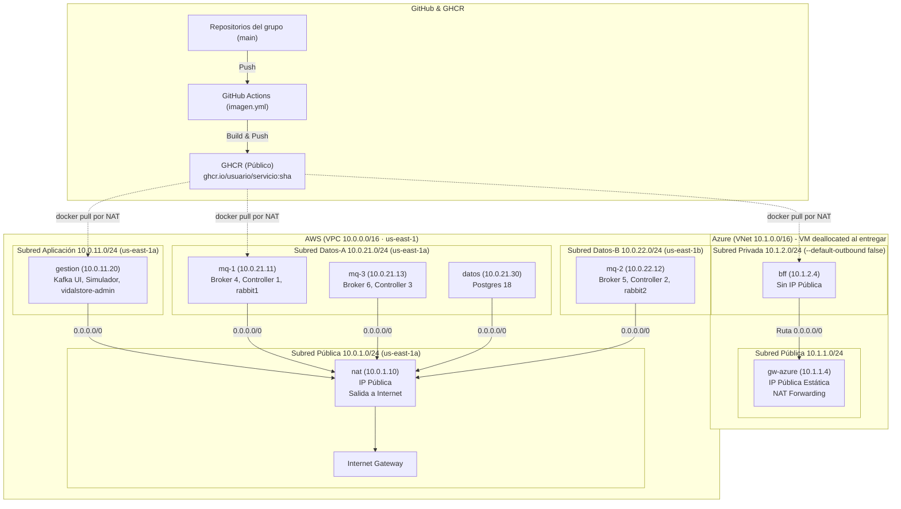
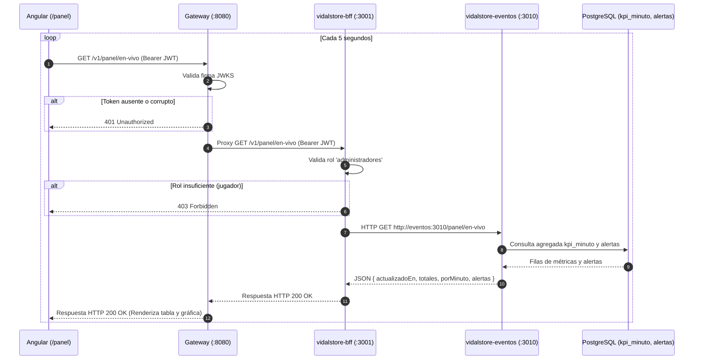

# D14 · La E2 de Punta a Punta: Confirmar, Medir, Repartir y Desplegar

> **DSY1107 - Desarrollo Cloud Native I**  
> **Semana 14 · Unidad 3: Streaming de Eventos con Apache Kafka**  
> **Docente:** Cristian Calderón (`cr.calderons@profesor.duoc.cl` / `Umbingelelo`)  
> **Hito Normativo:** Evaluación Parcial N°3 — Entrega 2 (E2) · Viernes 13 de noviembre, 23:59  
> **Ponderación:** 35% del encargo total de la EP3  

---

## 1. Resumen Ejecutivo y Objetivos de Aprendizaje

La clase magistral **D14** articula e integra el ciclo de vida completo de la **Entrega 2 (E2)** de la EP3, estructurándola en **cuatro tramos interdependientes**:
$$\text{El Consumidor (IE5)} \longrightarrow \text{Repartir y Medir (IE8)} \longrightarrow \text{Replicar (IE7)} \longrightarrow \text{Desplegar (GHCR, AWS, Azure)}$$

> *«Cada tramo usa lo anterior: no se reparte bien lo que no se procesa bien».*

### Competencias Clave Demostrables en D14
1. **Comprender el Ciclo de Confirmación:** Explicar con precisión por qué el commit manual del offset va estrictamente después del `INSERT` en PostgreSQL y cómo la restricción `UNIQUE (evento_id)` asegura un procesamiento de semántica *resultado exactamente una vez* (*effectively exactly-once*), incluso ante fallas de proceso o duplicados.
2. **Aplicar Diagnóstico de Lag y Reparto:** Calcular e interpretar el consumer lag por partición (`LOG-END-OFFSET - CURRENT-OFFSET`) y la asignación de particiones leyendo la salida de `kafka-consumer-groups.sh --describe` y `--members`. Demostrar el rebobinado de un grupo sin alterar los offsets de los demás grupos.
3. **Comprender Resiliencia y Replicación:** Relacionar matemáticamente el factor de replicación 3 (`replication.factor=3`), `min.insync.replicas=2` y `acks=all` con la cantidad exacta de brokers caídos que tolera un topic sin perder transacciones, justificándolo en `docs/topics.md`.
4. **Comprender el Despliegue Multi-Nube:** Trazar el camino de cada microservicio desde el push en Git hasta la nube: construcción multi-stage y publicación pública con SHA en GHCR, red privada de AWS con salida exclusiva por instancia `nat` y administración por Session Manager (sin puerto 22), y red privada de Azure con `gw-azure` y máquinas desasignadas (`VM deallocated`).

---

## 2. Pauta Oficial de Corrección de la E2 (100 Puntos)

La E2 evalúa 100 puntos distribuidos estrictamente en **60 puntos de Kafka** y **40 puntos de ingeniería de software/nube**:

| Indicador | Qué se corrige exactamente | Puntos | Slides D14 |
|---|---|:---:|:---:|
| **IE5 Consumidores** | Tres consumidores en su archivo y módulo propio; commit manual tras escribir; escrituras idempotentes; coincidencia exacta con las cifras del dataset; panel en vivo operativo. | **22** | 5 a 17 |
| **IE8 Consumer Groups** | Tres consumer groups con nombre propio (`vidalstore-panel`, `vidalstore-alertas`, `vidalstore-historial`); dos de ellos leyendo sobre el mismo topic; reparto de particiones demostrado con 4 instancias en `docs/consumer-groups.md`. | **19** | 19 a 24 |
| **IE7 Topics** | Parámetros de topics en el repositorio y justificados rigurosamente en `docs/topics.md` (particiones, réplicas, `min.insync.replicas`, retención y keys). | **19** | 25 a 28 |
| **Compila y Git** | Clon limpio que compila y levanta con un solo comando (`bash levantar.sh`); historial de Git higiénico con pull requests revisados. | **10** | 39 |
| **Imágenes en GHCR** | Un GitHub Actions workflow por repositorio con servicio; imagen etiquetada con el SHA del commit de `main`; paquetes configurados como **Public**. | **10** | 29 a 31 |
| **Redes y Datos** | Red de AWS sin puerto 22 abierto, corriendo Kafka KRaft (3+3), RabbitMQ y Postgres; red de Azure con subred privada y las dos VMs en estado `deallocated`; scripts en `deploy/` y `docs/despliegue.md`. | **20** | 32 a 38 |
| **TOTAL** | | **100** | |

> [!CAUTION]
> ### La Regla de Oro del 30% (Slide 3)
> **«60 puntos son Kafka y 40 son ingeniería. Si `bash levantar.sh` no deja el sistema arriba, los indicadores IE5, IE7 e IE8 quedan automáticamente con un tope de 30%».**  
> Si el script de arranque falla, la nota máxima alcanzable se desploma a **58 puntos de 100** ($40 \text{ ing.} + 30\% \times 60 \text{ kafka} = 40 + 18 = 58$), resultando en reprobación automática del hito.

---

## 3. Arquitectura Multi-Nube de VidalStore en la E2 (Slide 4)



### Componentes de la E2 vs Novedades de la E3
- **En la E2 (se crea y valida ahora):**
  - **AWS:** Máquinas `nat`, `gestion`, `mq-1`, `mq-2`, `mq-3` y `datos`. Clúster Kafka KRaft operativo, clúster RabbitMQ operativo, Postgres inicializado y simulador reproduciendo.
  - **Azure:** VNet, subredes, tabla de rutas, `gw-azure` y `bff`. Se prueban con `curl https://api.ipify.org` y **quedan desasignadas (`Stopped (deallocated)`)** antes de la entrega.
- **En la E3 (llega después):**
  - `gw-aws` (10.0.1.20 con Elastic IP, Caddy y Gateway en AWS).
  - `servicios` (10.0.11.10 alojando catálogo, licencias y vidalstore-eventos en AWS).
  - Caddy, frontend y gateway alojados en `gw-azure` en Azure.

---

## 4. Dos Topics, Tres Consumer Groups y Persistencia Relacional (Slide 5)

| Topic | Key | Particiones | Consumer Group | Módulo / Archivo | Tabla Postgres | Qué calcula y Cifras Dataset |
|---|:---:|:---:|---|---|---|---|
| `vidalstore.actividad` | `juegoId` | 3 (p0, p1, p2) | `vidalstore-alertas` | `alertas/alertas.consumidor.ts` | `alertas` (por juego y ventana de 5 min) | Dispara si >20% en error con mínimo de partidas. **Cifra dataset:** Juego `1328670` (21:30–21:35) con **68/69 en error** (98.6%). |
| `vidalstore.actividad` y `vidalstore.compras` | `juegoId` y `usuarioSub` | 6 (3 + 3) | `vidalstore-panel` | `panel/panel.consumidor.ts` | `kpi_minuto` (por minuto y juego) | Partidas en curso al cierre del minuto y ventas acumuladas. **Cifras dataset:** **362 en curso a las 22:00**, máx **480 a las 21:46**, **380 compras por 6.291.370 CLP**. |
| `vidalstore.compras` | `usuarioSub` | 3 (p0, p1, p2) | `vidalstore-historial` | `historial/historial.consumidor.ts` | `ventas_semana` (por semana y juego) | Ventas netas descontando revocaciones. **Cifras dataset:** **380 compras, 15 revocaciones, 6.032.190 CLP netos**. |

> [!NOTE]
> ### Dos Grupos sobre el Mismo Topic (Slide 21)
> `vidalstore-panel` y `vidalstore-alertas` leen `vidalstore.actividad` en paralelo. En Kafka, **leer no borra el mensaje**: cada consumer group mantiene su propio puntero (`CURRENT-OFFSET`) por partición en el topic interno `__consumer_offsets`.  
> Si se detiene `vidalstore-alertas`, su offset queda estático; `vidalstore-panel` sigue procesando y llega a lag 0. Cuando `alertas` se reanuda, continúa exactamente donde quedó y alcanza el log end offset sin alterar a `panel`.

---

## 5. El Panel en Vivo y la Arquitectura de Petición (Slides 6 a 8)

El panel administrativo en vivo (`/panel`) en Angular se actualiza automáticamente cada 5 segundos.

### Flujo de Datos de Cada Refresco
1. **Frontend Angular (`/panel`):** Lanza `GET http://localhost:8080/v1/panel/en-vivo` con token JWT en cabecera `Authorization`.
2. **API Gateway (`:8080`):** Valida la firma del token contra Cognito JWKS. Si el token es inválido o no existe, responde `401 Unauthorized`. Si es válido, reenvía al BFF.
3. **Backend for Frontend (`:3001`):** Verifica el claim `cognito:groups`. Si el usuario no tiene el rol `administradores`, responde `403 Forbidden`. Si está autorizado, realiza petición HTTP `GET http://eventos:3010/panel/en-vivo`.
4. **Microservicio Eventos (`:3010`):** Es el **único dueño del esquema de lectura de streaming** (`kpi_minuto` y `alertas`). Ejecuta la consulta a Postgres y retorna el agregado estructurado en JSON.



> [!IMPORTANT]
> ### Pregunta de Examen / Quiz D14 (Slide 8)
> **Pregunta:** El administrador abre `/panel` y el BFF necesita las partidas en curso de las 21:46. ¿De dónde las obtiene?  
> - **A:** Abre una conexión a Postgres y consulta `kpi_minuto`. $\rightarrow$ **INCORRECTO.** Viola el principio de microservicios: la tabla tiene un solo dueño (`vidalstore-eventos`). Si el BFF la consulta directo, cualquier cambio de esquema rompe dos servicios.  
> - **B: Se las pide por HTTP a `vidalstore-eventos`. $\rightarrow$ ¡CORRECTO!** El dueño del bounded context responde la consulta encapsulando su modelo de persistencia.  
> - **C:** Se suscribe a `vidalstore.actividad` y cuenta él mismo. $\rightarrow$ **INCORRECTO.** Solo contaría eventos que lleguen desde el momento en que se abre la página, perdiendo el histórico y duplicando innecesariamente la lógica del consumidor.  
> - **D:** Angular las calcula leyendo Kafka. $\rightarrow$ **INCORRECTO.** El navegador web jamás se conecta a brokers de Kafka ni expone sockets de mensajería interna.

---

## 6. Mecanismo de Consumo, Commit Manual e Idempotencia (Slides 9 a 13)

### El Ciclo Innegociable del Consumidor
Para cada mensaje recibido de la partición:
1. **Validación Formal (Contrato DTO):** Pasar el payload por `Contrato<T>.validar()`. Si el JSON está truncado o la versión/esquema no coincide, se atrapa la excepción `EventoInvalido`, se registra el error en log estructurado y **se confirma el offset inmediatamente** (`commit = offset + 1`).
   - *¿Por qué se confirma el evento inválido?* Porque un evento envenenado o que viola el contrato fallará siempre. Si no se confirma el offset, el consumidor quedará releyéndolo infinitamente (*poison pill loop*) y la partición se detendrá con el consumer lag creciendo sin tope.
2. **Escritura en Persistencia (INSERT Idempotente):** Persistir en PostgreSQL mediante sentencia protegida contra duplicados:
   ```sql
   INSERT INTO kpi_minuto (evento_id, minuto, juego_id, iniciadas, terminadas, errores)
   VALUES ($1, $2, $3, $4, $5, $6)
   ON CONFLICT (evento_id) DO NOTHING
   RETURNING evento_id;
   ```
   - Si `RETURNING` devuelve 0 filas, el evento era repetido: se detecta el duplicado, no se suma nuevamente y no se lanza error.
3. **Commit Manual del Offset:** Únicamente **después de que Postgres confirmó la transacción** (o tras registrar el evento inválido), el consumidor llama a `mensaje.commit()` (`autocommit: false`).
   - Si la base de datos se cae (`ECONNREFUSED` / timeout), **NO se hace commit**: la partición debe fallar y reintentar, ya que confirmar un mensaje no escrito significaría **pérdida irreversible de datos**.

> [!IMPORTANT]
> ### Pregunta de Examen / Quiz D14 (Slide 10)
> **Pregunta:** Tu consumidor de `vidalstore-panel` valida el evento, hace el INSERT en `kpi_minuto` y confirma el offset. ¿En qué lugar del código va el commit?  
> - **A:** Apenas llega el mensaje, antes del INSERT. $\rightarrow$ **INCORRECTO.** Si el contenedor o proceso muere entre el commit y el INSERT, Kafka asume que el evento ya se procesó: el evento se pierde silenciosamente (*at-most-once*).  
> - **B:** Que el cliente confirme solo, cada pocos segundos (`autocommit: true`). $\rightarrow$ **INCORRECTO.** El autocommit confirma por reloj (intervalo de tiempo), no por trabajo efectivamente terminado en base de datos. Es uno de los errores que más descuenta puntaje en IE5.  
> - **C: Después de escribir; y si el evento no cumple el contrato, después de registrarlo. $\rightarrow$ ¡CORRECTO!** Primero se asegura la persistencia, luego se confirma. El evento inválido se registra y confirma para evitar bloquear la partición. Si falla Postgres, se reintenta sin confirmar.  
> - **D:** Solo cuando el INSERT funcionó; un evento inválido queda sin confirmar. $\rightarrow$ **INCORRECTO.** El evento inválido fallará siempre; sin commit, el consumidor queda atrapado reintentando el veneno y la partición queda congelada.

### Simulación en Memoria: `consumidor.mjs` (Slide 12)
El principio se valida con el script mínimo en Node.js puro de 21 líneas:
```javascript
const particion = [
  '{"eventoId":"e1","version":1}',
  '{"eventoId":"e2","version":1}',
  '{"eventoId":"e1","version":1}', // Duplicado (simula los 17 duplicados del dataset)
  '{"eventoId":"e3","version":99}', // Inválido (simula los 34 inválidos del dataset)
  '{"eventoId":"e4","version":1}'
];
const tabla = new Set(); // Simula UNIQUE (evento_id)
let commit = 0;          // Próximo offset que solicitará el grupo

function validar(texto) {
  const ev = JSON.parse(texto);
  if (ev.version !== 1) throw new Error(`${ev.eventoId} no cumple contrato`);
  return ev;
}

function insertar(ev) {
  if (tabla.has(ev.eventoId)) return 'duplicado, no suma';
  tabla.add(ev.eventoId);
  return 'insertado';
}

for (const [offset, texto] of particion.entries()) {
  try {
    console.log(offset, insertar(validar(texto)));
  } catch (error) {
    console.log(offset, 'registrado:', error.message);
  }
  commit = offset + 1; // Commit manual SIEMPRE después de escribir o registrar
}
console.log('filas:', tabla.size, '· commit:', commit);
// Salida esperada:
// 0 insertado
// 1 insertado
// 2 duplicado, no suma
// 3 registrado: e3 no cumple contrato
// 4 insertado
// filas: 3 · commit: 5
```

### Predicción de Fallo: Muerte entre el INSERT y el Commit (Slide 13)
Si el contenedor se reinicia abruptamente tras escribir `e4` en la base de datos pero **antes** de enviar el commit del offset 4 a Kafka:
1. En PostgreSQL la fila `e4` ya existe.
2. En Kafka el último commit registrado sigue siendo `commit = 4`.
3. Al reiniciar, Kafka vuelve a entregar el offset 4 (`e4`).
4. El consumidor intenta insertar `e4`, pero choca con la restricción `UNIQUE (evento_id)`.
5. La sentencia `ON CONFLICT DO NOTHING` no altera los totales ni añade una segunda fila.
6. El consumidor avanza y ejecuta el commit del offset 5.
7. **Resultado:** Aunque la entrega es *al menos una vez* (*at-least-once*), la persistencia queda con exactamente 3 filas (*resultado exactamente una vez*).

---

## 7. Ventanas Temporales y la Regla del Mínimo de Partidas (Slides 14 a 16)

### La Trampa del Reloj Local vs `emitidoEn` (Slide 14)
- Cada evento transporta el campo `emitidoEn` en formato ISO 8601 UTC (`2026-11-07T00:46:12.345Z`).
- **Regla Estricta:** Las ventanas de agrupación del panel (1 minuto) y de las alertas (5 minutos) deben calcularse **exclusivamente con `emitidoEn`**, **JAMÁS con el reloj local (`new Date()` o `CURRENT_TIMESTAMP`)**.
- *¿Por qué?* Porque el simulador puede reproducir a `--velocidad 60` (la noche completa de 1 hora se emite en 60 segundos) o procesar datos históricos en un rebobinado. Si se usara `now()`, todos los eventos caerían en la misma ventana de 1 minuto local.
- **Zona Horaria:** Se procesa y almacena en UTC (`00:46 UTC`), y se proyecta a `America/Santiago` solo al renderizar en el frontend (`21:46 CLT` del viernes 6).

### Cifras de Autocomprobación del Panel
- Máximo de partidas en curso en toda la noche: **480 partidas a las 21:46**.
- Partidas en curso al cierre de cada minuto: $\text{Iniciadas acumuladas} - \text{Terminadas acumuladas}$ desde las 21:00.
- Validación por minuto entre las 21:00 y las 21:04:
  - **Actividad válida:** 24, 27, 48, 34 y 47 eventos.
  - **Compras válidas:** 16, 21, 16, 16 y 20 compras.

### La Regla del Mínimo de Partidas en `vidalstore-alertas` (Slides 15 y 16)
La regla de negocio estipula: Disparar alerta por juego en ventanas fijas de 5 minutos si más del 20% de las partidas terminadas fue error ($\frac{\text{errores}}{\text{terminadas}} > 0.20$).

> [!WARNING]
> Si una ventana tiene 1 sola partida terminada y esta terminó en error, la tasa es $\frac{1}{1} = 100\%$. Si no se exige un volumen mínimo, una única falla fortuita generaría una alerta espuria.

#### Ventanas del Dataset que Superan el 20% de Error:
| Juego ID | Ventana (CLT) | En Error / Terminadas | Total Partidas | ¿Alerta Real o Ruido? |
|:---:|:---:|:---:|:---:|:---:|
| `2379780` | 21:05 a 21:10 | 1 / 1 (100%) | 1 | Ruido (muestra insuficiente) |
| **`1328670`** | **21:30 a 21:35** | **68 / 69 (98.6%)** | **69** | **¡ALERTA REAL DEL DATASET!** Incidente masivo |
| `1203220` | 21:35 a 21:40 | 1 / 2 (50%) | 2 | Ruido |
| `1203220` | 21:40 a 21:45 | 1 / 2 (50%) | 2 | Ruido |
| `1145360` | 21:55 a 22:00 | 1 / 1 (100%) | 1 | Ruido |

> [!IMPORTANT]
> ### Pregunta de Examen / Quiz D14 (Slide 16)
> **Pregunta:** Tu grupo decide que una ventana solo puede disparar si tiene al menos 3 partidas terminadas. Con el dataset de la tabla anterior, ¿cuántas alertas quedan en la tabla `alertas`?  
> - **A:** Cinco. $\rightarrow$ **INCORRECTO.** Cinco son las ventanas que superan el 20% sin aplicar filtro de volumen mínimo.  
> - **B:** Cuatro, una por juego. $\rightarrow$ **INCORRECTO.** Ignora el umbral mínimo de 3 partidas.  
> - **C: Una: el juego 1328670 entre las 21:30 y las 21:35. $\rightarrow$ ¡CORRECTO!** Es la única ventana con 3 o más terminadas (tiene 69, con 68 en error = 98.6%). Las demás solo tienen 1 o 2 partidas.  
> - **D:** Ninguna. $\rightarrow$ **INCORRECTO.** 68 de 69 es el 98.6%, superando holgadamente el 20% y el mínimo de 3.

---

## 8. Orden Garantizado de Compra y Revocación por Clave de Partición (Slide 17)

En el caso VidalStore, el evento `licencia.revocada` **no incluye el precio de la licencia en su payload**.  
El consumidor `vidalstore-historial` debe descontar del neto de ventas el monto exacto cobrado originalmente en `compra.realizada` para esa misma licencia.

### ¿Por qué este diseño funciona de forma determinista y sin condiciones de carrera?
1. El productor de compras publica con clave de mensaje **`key = usuarioSub`**.
2. En Apache Kafka, la función de particionado por omisión calcula $\text{murmur2}(\text{key}) \pmod{\text{numParticiones}}$.
3. Dado que ambos eventos pertenecen al mismo jugador, **`compra.realizada` y `licencia.revocada` van a parar obligatoriamente a la misma partición**.
4. Dentro de una partición individual, **Kafka garantiza orden monotónico estricto de offsets**.
5. Como una licencia solo puede revocarse después de haberse comprado, `compra.realizada` siempre tiene un offset menor que `licencia.revocada`.
6. Cuando `licencia.revocada` es leída, `vidalstore-historial` encuentra con absoluta certeza el registro de la compra previa en su tabla interna y descuenta el valor exacto.

> [!CAUTION]
> Si la clave del topic `vidalstore.compras` fuera aleatoria, `licenciaId` o `juegoId`, la compra y la revocación podrían caer en particiones diferentes. Como las particiones se consumen de forma independiente y asíncrona, la revocación podría procesarse antes de la compra, fallando el descuento por inexistencia del registro previo.

**Cifras Totales del Dataset:**
- Compras procesadas: **380 compras**
- Revocaciones procesadas: **15 revocaciones**
- Ventas netas finales: **6.032.190 CLP** (Ventas brutas: 6.291.370 CLP)

---

## 9. Medir y Repartir: Lag y Escalado de Instancias (Slides 19 a 22)

### Definición y Métricas de Consumer Lag
$$\text{Consumer Lag} = \text{LOG-END-OFFSET} - \text{CURRENT-OFFSET}$$
- Si la partición acumula 1.751 eventos publicados y el grupo confirmó hasta el 1.100, el lag es $1.751 - 1.100 = 651$.
- Al finalizar la reproducción del simulador, **los tres consumer groups deben converger a Lag 0 en todas sus particiones**.

### Regla Fundamental de Particionamiento en un Consumer Group
- **Una partición solo puede ser consumida por un único consumidor dentro del mismo consumer group** en un instante dado.
- Por tanto, el número de particiones define el límite máximo de paralelismo real del grupo.
- Si hay más instancias de consumidores que particiones, **las instancias sobrantes quedan completamente ociosas (`#PARTITIONS = 0`)**, conectadas al clúster y en espera pero sin consumir tráfico.

```
Topic: vidalstore.actividad (3 Particiones)
Consumer Group: vidalstore-alertas (4 Instancias de eventos)

[ Partición 0 ] (1.751 ev)  ───>  Instancia c1 (#PARTITIONS = 1)
[ Partición 1 ] (  520 ev)  ───>  Instancia c2 (#PARTITIONS = 1)
[ Partición 2 ] (  768 ev)  ───>  Instancia c3 (#PARTITIONS = 1)
                                  Instancia c4 (#PARTITIONS = 0)  <-- OCIOSA
```

> [!IMPORTANT]
> ### Pregunta de Examen / Quiz D14 (Slide 22)
> **Pregunta:** Levantas cuatro instancias de `vidalstore-eventos`. ¿Qué muestra la columna `#PARTITIONS` de `kafka-consumer-groups.sh --describe --members` para `vidalstore-alertas`, que lee solo `vidalstore.actividad`?  
> - **A:** 1, 1, 1 y 1. $\rightarrow$ **INCORRECTO.** El topic solo tiene 3 particiones; no existe una cuarta partición para entregar.  
> - **B: 1, 1, 1 y 0. $\rightarrow$ ¡CORRECTO!** Cada partición la atiende una sola instancia; la cuarta instancia queda ociosa. Esta evidencia debe constar en `docs/consumer-groups.md`.  
> - **C:** 3, 0, 0 y 0: la primera que llega se queda con todo. $\rightarrow$ **INCORRECTO.** El protocolo de asignación de Kafka (`RangeAssignor` / `RoundRobinAssignor`) reparte balanceadamente.  
> - **D:** Las cuatro leen la P0, que es la más cargada. $\rightarrow$ **INCORRECTO.** En un consumer group una partición jamás se divide entre dos instancias; dividirla rompería la garantía de orden monotónico.

*(Para `vidalstore-panel`, que lee 2 topics con 3 particiones cada uno = 6 particiones en total, 4 instancias se distribuyen en **2, 2, 1 y 1** particiones).*

---

## 10. Procedimiento de Rebobinado vs Demostración en Defensa (Slides 23 y 24)

### Rebobinar `vidalstore-historial` a `offset 0`
Rebobinar consiste en resetear el cursor del grupo al inicio (`--to-earliest`) para reprocesar la historia completa de eventos tras un cambio en la lógica de negocio o corrección de bugs:
```bash
docker compose exec broker-1 /opt/kafka/bin/kafka-consumer-groups.sh \
  --bootstrap-server broker-1:19092 --group vidalstore-historial \
  --topic vidalstore.compras --reset-offsets --to-earliest --execute
```

### La Restricción de Estado Inactivo (`Stable` vs `Inactive`)
Si se ejecuta el comando anterior mientras el servicio `vidalstore-eventos` está en ejecución, Kafka rechaza la operación con el error:
> `Assignments can only be reset if the group 'vidalstore-historial' is inactive, but the current state is Stable.`

### Pasos Rigurosos para Rebobinar:
1. **Detener el consumidor:** `docker compose stop eventos`.
2. **Esperar el vencimiento de la sesión:** Esperar aproximadamente 10 a 30 segundos (dentro del `session.timeout.ms`) hasta que el grupo pase a estado `Empty` / `Dead`.
3. **Ejecutar el reset:** Ejecutar el comando con `--reset-offsets --to-earliest --execute` y verificar en la consola `NEW-OFFSET: 0` en las particiones 0, 1 y 2.
4. **Reiniciar el consumidor:** `docker compose start eventos`.
5. **Verificar Idempotencia y Reconstrucción:** Comprobar que la tabla `ventas_semana` reconstruye las cifras exactas (**380 compras, 15 revocaciones, 6.032.190 CLP**) sin duplicar montos.

> [!CAUTION]
> ### Advertencia Crucial para la Defensa Técnica (Slide 24)
> **«Para repetir una demostración en la defensa NO se rebobina: se vacían las tablas de lectura con `TRUNCATE` en PostgreSQL y se reproduce otra vez el simulador con `node reproducir.mjs`».**  
> El reseteo de offsets es para mantenimiento operacional; ante el docente, la prueba de punta a punta se hace limpiando la base de datos y reemitiendo el flujo completo desde el simulador.

---

## 11. Replicación, ISR y Tolerancia a Fallos (Slides 25 a 28)

### Clúster KRaft de 3 Brokers (IDs 4, 5, 6)
- Cada topic tiene `replication.factor=3`. Cada partición posee 1 réplica líder y 2 réplicas seguidoras distribuidas entre los 3 brokers.
- Con el clúster completamente operativo, `kafka-topics.sh --describe` muestra `Isr: 5,6,4` para todas las particiones.

### Matriz de Resiliencia: `acks=all` y `min.insync.replicas=2`

| Brokers Caídos | Nodos en ISR | ¿Se puede publicar? | Comportamiento del Productor y Broker | Estado de los Eventos Confirmados |
|:---:|:---:|:---:|---|---|
| **Ninguno (0)** | 3 de 3 | **✓ SÍ** | Publicación exitosa; el líder espera confirmación de las 3 réplicas antes de responder. | Confirmado y persistido en 3 copias de disco. |
| **Uno (1)** | 2 de 3 | **✓ SÍ** | Publicación exitosa; $2 \ge \text{min.insync.replicas}$. Los 401 eventos de compras se confirman con éxito. | Confirmado y persistido en 2 copias de disco. |
| **Dos (2)** | 1 de 3 | **✗ NO** | El broker **rechaza la escritura con `NOT_ENOUGH_REPLICAS`**. | Lo confirmado anteriormente sigue seguro en disco; **no se confirma nada nuevo en una sola copia**. |
| **Tres (3)** | 0 de 3 | **✗ NO** | Clúster indisponible (`ECONNREFUSED` / timeout). | Datos seguros en disco en los volúmenes montados. |

> [!TIP]
> **Justificación Técnica Obligatoria en `docs/topics.md`:**  
> Rechazar escrituras con 2 brokers caídos es el **comportamiento deseado y correcto de diseño**: en compras financieras, jamás se debe confirmar una transacción si solo existe 1 copia activa, pues la falla de ese único disco causaría pérdida irrevocable de dinero.

### Configuración Oficial Justificada de Topics (Slide 27):
```bash
# Topic de Compras (Se rebobina, retención de 7 días, key usuarioSub, acks=all)
docker exec broker-1 /opt/kafka/bin/kafka-topics.sh --bootstrap-server broker-1:19092 \
  --create --topic vidalstore.compras --partitions 3 --replication-factor 3 \
  --config min.insync.replicas=2 --config retention.ms=604800000

# Topic de Actividad (Retención operativa de 24 horas, key juegoId)
docker exec broker-1 /opt/kafka/bin/kafka-topics.sh --bootstrap-server broker-1:19092 \
  --create --topic vidalstore.actividad --partitions 3 --replication-factor 3 \
  --config min.insync.replicas=2 --config retention.ms=86400000
```

---

## 12. Publicación de Imágenes Multi-Stage en GHCR (Slides 29 a 31)

### Pipeline de Contenedores en GitHub Actions
- Cada push a `main` activa `.github/workflows/imagen.yml` en los 7 repositorios con servicios.
- La imagen se etiqueta obligatoriamente con el commit SHA: `ghcr.io/<usuario>/<servicio>:<sha>`.
- **Dockerfile Multi-Stage en 2 Etapas:**
  1. `builder`: Basado en `node:24-slim`, instala dependencias completas de desarrollo (`devDependencies`) y ejecuta `npm run build`.
  2. `producción`: Basado en `node:24-slim`, copia únicamente el artefacto compilado (`dist/`), instala dependencias de producción (`npm ci --omit=dev`), define `USER node` y no contiene herramientas de build.

> [!IMPORTANT]
> ### Pregunta de Examen / Quiz D14: Error `unauthorized` al Descargar (Slide 31)
> **Pregunta:** El workflow terminó en verde y la imagen aparece en tu perfil. En la nube, una máquina de AWS pide `ghcr.io/.../vidalstore-eventos:<sha>` y GHCR responde `unauthorized`. ¿Qué pasó?  
> - **A:** Falta copiar tu token de GitHub a la máquina. $\rightarrow$ **INCORRECTO.** Las máquinas de la nube no almacenan credenciales ni tokens personales de GitHub; las imágenes deben ser accesibles anónimamente.  
> - **B: El paquete quedó Private, como GitHub crea cada imagen nueva por omisión. $\rightarrow$ ¡CORRECTO!** Se resuelve una única vez por repositorio en *GitHub $\to$ Packages $\to$ Package settings $\to$ Change visibility $\to$ Public*.  
> - **C:** Hay que pedir `latest` en vez del SHA. $\rightarrow$ **INCORRECTO.** El tag no modifica las políticas de autorización, y la pauta exige desplegar por SHA inmutable.  
> - **D:** La máquina no tiene internet. $\rightarrow$ **INCORRECTO.** Si la máquina no tuviera salida a internet, arrojaría error de resolución DNS (`ENOTFOUND`) o de conexión (`ETIMEDOUT`), no una respuesta HTTP `401 Unauthorized` de GHCR.

---

## 13. Redes en AWS y Azure: Secretos y Pruebas (Slides 32 a 38)

### Red en AWS (VPC 10.0.0.0/16 · Slides 33 a 35)
- **Cero Puerto 22 Abierto:** Ningún Security Group permite tráfico inbound por el puerto 22. Toda la administración se realiza a través de **AWS Systems Manager (Session Manager)** utilizando el rol IAM `LabInstanceProfile`.
- **Dependencia Crítica de la Instancia `nat`:** Las instancias en subredes privadas (`mq-1..3`, `datos`, `gestion`) no tienen IP pública asignada. Su única vía hacia internet (para descargar Docker, instalar paquetes, contactar a GitHub Container Registry, comunicarse con S3 y con los endpoints de Session Manager) es la ruta `0.0.0.0/0` apuntando a la interfaz de `nat` (10.0.1.10).

> [!IMPORTANT]
> ### Pregunta de Examen / Quiz D14: Instancia NAT Apagada (Slide 35)
> **Pregunta:** El Learner Lab se reinició, levantaste `mq-1` y `nat` quedó detenida. ¿Qué ves?  
> - **A:** `mq-1` aparece en Session Manager porque tiene el rol `LabInstanceProfile`. $\rightarrow$ **INCORRECTO.** El rol otorga los permisos en IAM, pero el agente `amazon-ssm-agent` de la máquina necesita comunicarse con los servidores de AWS en internet, y su única ruta de salida es `nat`.  
> - **B: `mq-1` no aparece Online en Session Manager ni puede bajar Docker. $\rightarrow$ ¡CORRECTO!** Sin `nat`, las máquinas privadas están totalmente incomunicadas del exterior. La instancia `nat` debe encenderse en primer lugar.  
> - **C:** Entras a `mq-1` por SSH mientras tanto. $\rightarrow$ **INCORRECTO.** El puerto 22 está cerrado, no hay par de llaves inyectado y la máquina no posee IP pública.

### Red en Azure (VNet 10.1.0.0/16 · Slides 36 a 38)
- Subred pública (10.1.1.0/24) con `gw-azure` (10.1.1.4) asociada a IP pública estática con FQDN.
- Subred privada (10.1.2.0/24) con `bff` (10.1.2.4) configurada con `--default-outbound false`.
- Tabla de rutas de la subred privada con regla `0.0.0.0/0 -> 10.1.1.4`.
- Acceso SSH a `bff` exclusivamente mediante Jump Host (Bastion) a través de `gw-azure`:
  ```bash
  ssh -i ~/.ssh/vidalstore-azure -J azureuser@<ip-publica-gw-azure> azureuser@10.1.2.4
  ```
- **Verificación de Salida por NAT desde `bff`:**
  ```bash
  curl -s https://api.ipify.org
  # Debe responder exactamente la IP PÚBLICA DE GW-AZURE, confirmando que el NAT traduce la salida.
  ```

> [!IMPORTANT]
> ### Pregunta de Examen / Quiz D14: Fallo de Enrutamiento en Azure (Slide 38)
> **Pregunta:** Creaste la tabla de rutas `0.0.0.0/0 -> 10.1.1.4` y la asociaste a la subred privada. En `bff`, `curl https://api.ipify.org` no responde. ¿Qué falta?  
> - **A:** Darle una IP pública a `bff`. $\rightarrow$ **INCORRECTO.** La pauta prohíbe explícitamente IP pública en `bff`; debe salir exclusivamente por `gw-azure`.  
> - **B: Que `gw-azure` reenvíe y traduzca: IP forwarding en su interfaz de red y las reglas de iptables (NAT) del cloud-init. $\rightarrow$ ¡CORRECTO!** La tabla de rutas solo empuja los paquetes hasta la interfaz de `gw-azure`. Si la máquina no tiene `IP Forwarding` habilitado a nivel de Azure NIC y las reglas `POSTROUTING MASQUERADE` en `iptables`, los paquetes son descartados. *(Además: si el script `cloud-init` contenía tildes o caracteres especiales, Azure lo descarta íntegramente en silencio).*  
> - **C:** Quitar `--default-outbound false` de la subred privada. $\rightarrow$ **INCORRECTO.** Si se quitara, Azure le asignaría una IP de salida transparente por omisión, eludiendo a `gw-azure` y dejando sin probar el NAT requerido.

> [!CAUTION]
> ### Condición de Entrega en Azure (Slide 37)
> Al momento de entregar la E2, las dos máquinas virtuales de Azure (`gw-azure` y `bff`) deben quedar en estado **`Stopped (deallocated)`** ejecutando `az vm deallocate`.  
> Una VM en estado `deallocated` no consume créditos de cómputo del presupuesto del grupo, y preserva la IP pública estática y los discos para reactivarse con `az vm start` en la defensa.

---

## 14. Paquete de Entrega y Flujo de Corrección Docente (Slide 39)

### Estructura Inalterable del Archivo ZIP
El grupo entrega un **único archivo `.zip`** en la plataforma AVA (con copia al correo del docente):  
`entrega-e2-grupoNN-seccion.zip`

```
entrega-e2-grupoNN-seccion.zip
├── repositorios.md
├── informe.pdf
└── envs/
    ├── vidalstore-plataforma/.env
    ├── vidalstore-eventos/.env
    ├── vidalstore-admin/.env
    ├── vidalstore-bff/.env
    ├── vidalstore-catalogo/.env
    ├── vidalstore-licencias/.env
    ├── vidalstore-gateway/.env
    └── vidalstore-frontend/.env
```

1. **`repositorios.md`:** Tabla congelada con una fila por repositorio, indicando la URL de GitHub, el commit SHA exacto de `main` a las 23:59, el comando de arranque, las imágenes de GHCR, el bucket de S3 y qué integrante aloja cada nube.
2. **`envs/`:** Carpeta con los archivos `.env` reales y funcionales de cada componente, organizados en subcarpetas con el nombre exacto de cada repositorio.
3. **`informe.pdf`:** Integrantes, diagramas de arquitectura de red y consumer groups, y capturas de pantalla de respaldo (nubes, GHCR en Public, Kafka UI y `/panel`).

### El Protocolo de Corrección del Profesor Umbingelelo (Slide 39):
1. **Paso 1 (Clonar):** El docente clona cada repositorio listado en `repositorios.md` situándose en el commit SHA de `main` a las 23:59.
2. **Paso 2 (Descomprimir Secretos):** Descomprime la carpeta `envs/` al lado de los clones, inyectando cada `.env` en su repositorio respectivo.
3. **Paso 3 (Levantar con un solo comando):** Se posiciona en `vidalstore-plataforma` y ejecuta:
   ```bash
   bash levantar.sh
   ```
   *(Si el sistema completo no sube y queda saludable, se aplica el tope del 30% a IE5, IE7 e IE8).*
4. **Paso 4 (Revisar):** Comprueba el panel en vivo, las métricas del dataset, y revisa `informe.pdf` y `docs/despliegue.md`.

---

## 15. Banco de Preguntas Oficiales y Quizzes de D14

### Q.1. ¿Por qué el commit del offset se realiza estrictamente después del INSERT y no antes?
**Respuesta:** Porque si el commit se ejecutara antes de escribir en la base de datos y el proceso sufriera un reinicio abrupto (caída de contenedor, fallo de kernel, OOM killer), Kafka registraría el evento como confirmado y no lo volvería a entregar jamás, produciendo una pérdida silenciosa e irreparable de información (*at-most-once*). Al confirmar tras la escritura, si el proceso muere, Kafka reentrega el evento y la restricción `UNIQUE` en la base de datos absorbe la duplicación sin afectar las métricas (*at-least-once* con resultado idempotente).

### Q.2. ¿Qué ocurre con el commit si un evento viola el contrato DTO vs si PostgreSQL sufre una caída de conexión?
**Respuesta:** 
- Si el evento viola el contrato (JSON roto o campo faltante), el consumidor registra el evento inválido en log y **sí realiza el commit del offset**. Esto evita que el mensaje se convierta en una *poison pill* que congele la partición reintentando eternamente.
- Si lo que falla es PostgreSQL (`ECONNREFUSED` o timeout), el consumidor **NO realiza commit** y relanza el error para que el framework reintente o el proceso reinicie. Confirmar el offset sin haber guardado en la base de datos destruiría el evento.

### Q.3. ¿Por qué la agregación de métricas de ventanas temporales debe usar `emitidoEn` y no la hora del servidor?
**Respuesta:** Porque la hora del servidor refleja el momento en que el mensaje fue recibido por Kafka o procesado localmente, lo cual depende de la velocidad de reproducción del simulador (ej. `--velocidad 60` emite una hora en un minuto) o de si se está rebobinando un grupo histórico. El atributo `emitidoEn` es inmutable y representa el instante cronológico real en que aconteció el suceso en el dominio de negocio.

### Q.4. ¿Por qué `vidalstore.compras` utiliza `usuarioSub` como key y qué problema ocurriría si fuera aleatoria?
**Respuesta:** Porque `usuarioSub` garantiza que todas las compras y revocaciones de un mismo jugador se enruten a la misma partición física. En Kafka, las particiones garantizan orden estricto de entrega. Como una revocación (`licencia.revocada`) no transporta precio, el consumidor de historial confía en que la compra original (`compra.realizada`) ya fue leída y registrada en su tabla local. Con una key aleatoria, la revocación podría ser procesada antes que la compra por correr en particiones independientes, fallando el descuento del dinero neto.

### Q.5. ¿Por qué al levantar 4 instancias de `vidalstore-eventos`, `vidalstore-alertas` muestra `#PARTITIONS: 1, 1, 1 y 0`?
**Respuesta:** Porque `vidalstore.actividad` posee únicamente 3 particiones y la regla de diseño de Kafka estipula que una partición solo puede ser consumida por una única instancia dentro del mismo consumer group. Por lo tanto, tres instancias reciben una partición cada una y la cuarta instancia queda ociosa. En cambio, `vidalstore-panel` lee 6 particiones (3 de actividad y 3 de compras), por lo que reparte sus particiones en 2, 2, 1 y 1 entre las cuatro instancias.

### Q.6. ¿Por qué con `min.insync.replicas=2` y `acks=all`, el broker rechaza la escritura si se caen dos brokers en un clúster de tres?
**Respuesta:** Porque al caerse 2 brokers, el conjunto ISR (*In-Sync Replicas*) queda reducido a 1 réplica (únicamente el líder). Dado que $1 < \text{min.insync.replicas}=2$, el broker líder rechaza la petición con el código `NOT_ENOUGH_REPLICAS`. Esto evita confirmar transacciones críticas en una sola copia volátil, protegiendo al sistema de pérdida de compras ante una falla de hardware.

### Q.7. Si `nat` se apaga en AWS, ¿por qué `mq-1` no aparece en Session Manager a pesar de tener el rol `LabInstanceProfile` asignado?
**Respuesta:** Porque el rol IAM proporciona los permisos de autorización, pero el agente `amazon-ssm-agent` de la máquina necesita establecer una conexión de red saliente hacia los endpoints de AWS en internet. Dado que `mq-1` reside en una subred privada sin IP pública, su única ruta de salida es la instancia `nat`. Al estar apagada `nat`, el agente no puede comunicarse con AWS y la consola lo reporta como `Offline`.

### Q.8. ¿Por qué las máquinas virtuales de Azure deben quedar en estado `Stopped (deallocated)` antes de entregar la E2?
**Respuesta:** Porque el estado `Stopped (deallocated)` libera los recursos de cómputo en el hipervisor de Azure, deteniendo por completo el cobro de la tarifa por hora de CPU y RAM, preservando la cuota del presupuesto estudiantil. A la vez, mantiene intactos los discos administrados y la asignación de la IP pública estática de `gw-azure` para su rápida reactivación durante la defensa técnica.
